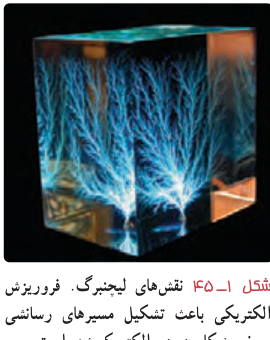
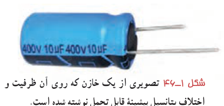
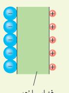

**فروریزش الکتریکی:** دیدیم که با قرار گرفتن مادۀ دی‌الکتریک بین صفحات خازن، ظرفیت خازن تغییر می‌کند. اثر دیگر حضور دی‌الکتریک‌ها در خازن، تغییر حداکثر ولتاژ قابل تحمل خازن است. اگر اختلاف پتانسیل دو صفحۀ یک خازن را به اندازۀ کافی زیاد کنیم، تعدادی از الکترون‌های اتم‌های مادۀ دی‌الکتریک، توسط میدان الکتریکی ایجادشده بین دو صفحه، کنده می‌شوند و مسیرهایی رسانا درون دی‌الکتریک¹ ایجاد می‌شود (شکل ۱ـ۴۵) که سبب تخلیۀ خازن می‌گردد. به این پدیده **فروریزش الکتریکی**² مادۀ دی‌الکتریک می‌گویند. فروریزش الکتریکی در عایق بین دو صفحۀ خازن‌ها معمولاً، با ایجاد یک جرقه همراه است و در بیشتر مواقع خازن را می‌سوزاند. خازن‌ها معمولاً با مقدار ظرفیت آنها و اختلاف پتانسیل بیشینه‌ای که می‌توانند تحمل کنند مشخص می‌شوند (شکل ۱ـ۴۶).

شکل ۱ـ۴۵ نقش‌های لیختنبرگ. فروریزش الکتریکی باعث تشکیل مسیرهای رسانای سرخشکلی در دی‌الکتریک شده است.

شکل ۱ـ۴۶ تصویری از یک خازن که روی آن ظرفیت و اختلاف پتانسیل بیشینۀ قابل تحمل نوشته شده است.

### تمرین ۱ـ۱۲

یک یاختۀ عصبی (نورون) را می‌توان با یک خازن تخت مدل‌سازی کرد، به‌طوری‌که غشای سلول به عنوان دی‌الکتریک و یون‌های باردار با علامت مخالف که در دو طرف غشا هستند به عنوان بارهای روی صفحه‌های خازن عمل کنند (شکل روبه‌رو). ظرفیت یک سلول عصبی و تعداد یون‌های لازم (با فرض آنکه هر یون یک بار یونیده باشد)، برای آنکه یک اختلاف پتانسیل $85\,\mathrm{mV}$ ایجاد شود چقدر است؟ فرض کنید غشا دارای ثابت دی‌الکتریک $\kappa=3/0$، ضخامت $10/0\,\mathrm{nm}$ و مساحت سطح $1/0\times10^{-10}\,\mathrm{m^2}$ است.

### فعالیت ۱ـ۱۱

خازن‌ها انواع متعددی دارند؛ زیرا برای کاربردهای مختلفی طراحی و ساخته می‌شوند. دربارۀ خازن‌های مختلف مانند خازن‌های ورقه‌ای، میکا، سرامیکی، الکترولیتی، خازن‌های متغیر، ابرخازن‌ها و ظرفیت آنها تحقیق کنید. هر گروه می‌تواند روی یک نوع خازن تحقیق کند.

## ۱ـ۱۲ انرژی خازن

وقتی صفحه‌های خازن دارای بار الکتریکی می‌شوند در خازن انرژی ذخیره می‌شود. برای اینکه انرژی ذخیره‌شده در خازن را مشاهده کنیم، کافی است دو سر یک خازن پرشده را به دو سر یک لامپ کوچک وصل کنیم. به‌شرط آنکه ظرفیت و اختلاف پتانسیل خازن به اندازۀ کافی زیاد باشد، لامپ برای مدتی روشن و سپس خاموش می‌شود. در هنگام شارژ شدن خازن توسط باتری، دائماً باری جزئی از یک صفحۀ خازن جدا و به همان اندازه به صفحۀ دیگر منتقل می‌شود. در این فرایند، طبق رابطۀ ۱ـ۱۳

۱ـ موسوم به نقش‌های لیختنبرگ (Lichtenberg)  ۲ـ Electrical Breakdown
