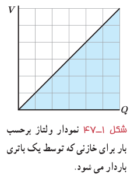
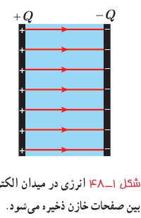
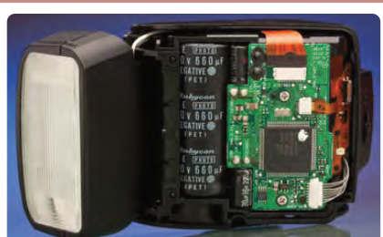

($W_{\text{خارجی}}=Q\Delta V$)، باتری روی این بار کار انجام می‌دهد. هنگام انتقال بار، اختلاف پتانسیل دو صفحۀ خازن نیز به‌آهستگی افزایش می‌یابد. بنابراین، برای انتقال بارهای بعدی به کار بیشتری نیاز است. بنا به رابطۀ ۱ـ۱۵ ($V=Q/C$) و با توجه به اینکه در این فرایند ظرفیت خازن همواره مقدار ثابتی است، اختلاف پتانسیل دو صفحۀ خازن تابعی خطی از بار ذخیره‌شده در آن می‌شود که به‌طور یکنواخت از صفر تا $V$ افزایش می‌یابد (شکل ۱ـ۴۷). بنابراین، در هنگام باردار شدن خازن می‌توان اختلاف پتانسیل متوسطی را به‌صورت $V_{av}=(V+0)/2$ برای دو صفحۀ خازن در نظر گرفت. آن‌گاه با استفاده از رابطۀ ۱ـ۱۳ کار انجام شده برای باردار شدن کامل خازن برابر با حاصل‌ضرب کل بارهای جزئی منتقل شده ($Q$) در اختلاف پتانسیل متوسط است:

$$W=QV_{av}=Q\left(\frac V2\right)=\frac12QV$$

شکل ۱ـ۴۷ نمودار ولتاژ برحسب بار برای خازنی که توسط یک باتری باردار می‌شود.

این کار به‌صورت انرژی پتانسیل الکتریکی در میدان الکتریکی فضای بین صفحه‌های خازن ذخیره می‌شود (شکل ۱ـ۴۸):

$$U_{\text{خازن}}=\frac12QV=\frac12CV^2=\frac12\frac{Q^2}{C}\tag{1-19}$$

که در آن انرژی پتانسیل الکتریکی خازن ($U_{\text{خازن}}$) برحسب ژول (J)، بار خازن ($Q$) برحسب کولن (C)، اختلاف پتانسیل دو صفحۀ خازن ($V$) برحسب ولت (V) و ظرفیت خازن ($C$) برحسب فاراد (F) است.

شکل ۱ـ۴۸ انرژی در میدان الکتریکی بین صفحات خازن ذخیره می‌شود.

### مثال ۱ـ۱۸

مدار یک فلاش عکاسی، انرژی را با ولتاژ ۳۳۰ V، در یک خازن $660\,\mu\mathrm F$، ذخیره می‌کند. الف) چه مقدار انرژی الکتریکی در این خازن ذخیره می‌شود؟ ب) اگر تقریباً همۀ این انرژی در مدت $1/0\,\mathrm{ms}$ آزاد شود، توان متوسط خروجی فلاش چقدر است؟

**پاسخ:** با توجه به رابطۀ ۱ـ۱۹ داریم

$$U=\frac12CV^2=\frac12(660\times10^{-6}\,\mathrm F)(330\,\mathrm V)^2=35/9\,\mathrm J$$

با توجه به تعریف توان داریم:

$$P_{av}=\frac Ut=\frac{35/9\,\mathrm J}{1/0\times10^{-3}\,\mathrm s}=3/6\times10^4\,\mathrm{J/s}=36\,\mathrm{kW}$$

که این تأیید گفته‌ای است که در ابتدای بخش ۱ـ۱۰ در مورد خازن بیان کردیم و گفتیم یک خازن باردار می‌تواند انرژی را با آهنگ بسیار بیشتری از یک باتری برای فلاش دوربین مهیا کند.
