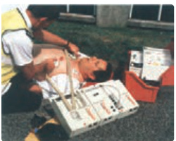

### مثال ۱ـ۱۹: دستگاه رفع لرزش نامنظم قلب (دفیبریلاتور¹)

توانایی خازن برای ذخیرۀ انرژی پتانسیل الکتریکی، اساس کار دستگاه‌های رفع لرزشی است که برای توقف لرزش بطنی افراد دچار حملۀ قلبی به‌کار می‌رود. در این بیماری، انبساط و انقباض ناهماهنگ قلب باعث می‌شود خون به‌درستی به مغز فرستاده نشود. در این دستگاه یک باتری، خازنی را تا اختلاف پتانسیل حدود $6\,\mathrm{kV}$ باردار می‌کند. صفحه‌های رابط (کفشک‌ها²) روی قفسۀ سینۀ بیمار قرار داده می‌شوند و خازن بخشی از انرژی ذخیره‌شدۀ خود را از طریق کفشک‌ها به بدن بیمار منتقل می‌کند. هدف از این کار این است که قلب به‌طور موقت از کار بیفتد و پس از آن با آهنگی منظم و طبیعی خود به کار افتد.

اگر ظرفیت خازن این دستگاه $11/0\,\mu\mathrm F$ باشد و با ولتاژ $6/00\,\mathrm{kV}$ شارژ شود و سپس تمام انرژی آن از طریق کفشک‌ها به درون بدن بیمار تخلیه شود، الف) چقدر انرژی در بدن بیمار تخلیه شده است؟ ب) چه مقدار بار الکتریکی از بدن بیمار عبور کرده است؟ پ) اگر تخلیۀ انرژی تقریباً در مدت $2/00\,\mathrm{ms}$ صورت پذیرفته باشد این انرژی با چه توان متوسطی در بدن بیمار تخلیه شده است؟

**پاسخ:** الف) انرژی ذخیره شده در خازن با استفاده از رابطۀ ۱ـ۱۹ به‌دست می‌آید:

$$U=\frac12CV^2=\frac12(11/0\times10^{-6}\,\mathrm F)(6/00\times10^3\,\mathrm V)^2=198\,\mathrm J$$

که با توجه به فرض مسئله این همان انرژی تخلیه شده در بدن بیمار است.

ب) بار اولیۀ روی صفحات خازن برابر است با

$$Q=CV\Rightarrow Q=(11/0\times10^{-6}\,\mathrm F)(6/00\times10^3\,\mathrm V)=6/60\times10^{-2}\,\mathrm C$$

با توجه به فرض مسئله، این همان باری است که از بدن بیمار عبور کرده است.

پ) توان متوسط انرژی تخلیه شده در بدن بیمار برابر است با

$$P_{av}=\frac Ut=\frac{198\,\mathrm J}{2/00\times10^{-3}\,\mathrm s}=99/0\,\mathrm{kW}$$

۱ـ Defibrillator  ۲ـ Paddles
