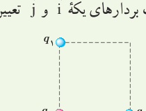
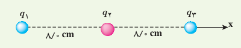
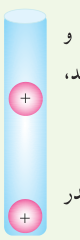
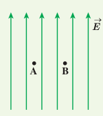
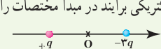

# پرسش‌ها و مسئله‌های فصل ۱

## ۱ـ۱ و ۱ـ۲ بار الکتریکی، پایستگی و کوانتیده بودن بار

**۱** چگونه توسط برق‌نما (الکتروسکوپ) می‌توانیم تشخیص دهیم که: الف) یک میله باردار است یا نه؟ ب) میله رساناست یا نارسانا؟ پ) نوع بار میلۀ باردار چیست؟

**۲** یک میلۀ پلاستیکی را با پارچۀ پشمی مالش می‌دهیم. پس از مالش، بار الکتریکی میلۀ پلاستیکی $-12/8\,\mathrm{nC}$ می‌شود. الف) بار الکتریکی ایجاد شده در پارچۀ پشمی چقدر است؟ ب) تعداد الکترون‌های منتقل‌شده از پارچۀ پشمی به میلۀ پلاستیکی را محاسبه کنید.

**۳** الف) بار الکتریکی اتم و هستۀ اتم کربن (${}^{12}_{6}\mathrm C$) چند کولن است؟ ب) بار الکتریکی اتم کربن یک بار یونیده ($\mathrm C^+$) چقدر است؟

## ۱ـ۳ قانون کولن

**۴** دو گوی رسانا، کوچک و یکسان با بارهای $q_1=4/0\,\mathrm{nC}$ و $q_2=-6/0\,\mathrm{nC}$ را با هم تماس می‌دهیم و سپس تا فاصلۀ $r=30\,\mathrm{cm}$ از هم دور می‌کنیم. نیروی برهم‌کنش الکتریکی بین دو گوی را محاسبه کنید. این نیرو رانشی است یا ربایشی؟

**۵** سه ذرۀ باردار $q_1$، $q_2$ و $q_3$ مطابق شکل در سه رأس مربعی به ضلع $3/0\,\mathrm m$ ثابت شده‌اند. اگر $q_1=q_2=-5/0\,\mu\mathrm C$ و $q_3=+0/20\,\mu\mathrm C$ باشد، نیروی خالص الکتریکی وارد بر بار $q_3$ را برحسب بردارهای یکۀ $\vec i$ و $\vec j$ تعیین کنید.

**۶** بارهای الکتریکی نقطه‌ای $q_1=-4/0\,\mathrm{nC}$، $q_2=+5/0\,\mathrm{nC}$ و $q_3=-4/0\,\mathrm{nC}$ مطابق شکل، در جای خود ثابت شده‌اند. نیروی خالص الکتریکی وارد بر هر یک از بارهای $q_1$ و $q_2$ را محاسبه کنید.

**۷** در شکل روبه‌رو، دو گوی مشابه به جرم $0/25\,\mathrm g$ و بار یکسان مثبت $q$ در فاصلۀ $1/0\,\mathrm{cm}$ از هم قرار دارند، به‌طوری که گوی بالایی به حالت معلق مانده است. الف) اندازۀ بار $q$ را به‌دست آورید. ب) تعداد الکترون‌های کنده‌شده از هر گوی چقدر است؟

## ۱ـ۴، ۱ـ۵ و ۱ـ۶ میدان الکتریکی، میدان الکتریکی حاصل از یک ذرۀ باردار و خطوط میدان الکتریکی

**۸** یک ذرۀ باردار را یک‌بار در نقطۀ A و بار دیگر در نقطۀ B قرار می‌دهیم. نیرویی که از طرف میدان الکتریکی بر این ذرۀ باردار در این دو نقطه وارد می‌شود را مقایسه کنید.

**۹** هستۀ اتم آهن شعاعی در حدود $4/0\times10^{-15}\,\mathrm m$ دارد و تعداد پروتون‌های آن ۲۶ عدد است. الف) بزرگی نیروی دافعه بین دو پروتون این هسته که به فاصلۀ $4/0\times10^{-15}\,\mathrm m$ از هم قرار دارند چقدر است؟ ب) اندازۀ میدان الکتریکی ناشی از هسته در فاصلۀ $1/0\times10^{-10}\,\mathrm m$ از مرکز هسته چقدر است؟

**۱۰** شکل زیر، دو ذرۀ باردار را نشان می‌دهد که در جای خود روی محور x ثابت شده‌اند. بارها در فاصلۀ یکسان $a$ از مبدأ مختصات (نقطۀ O) قرار دارند. الف) در کجای این محور (غیر از بی‌نهایت) نقطه‌ای وجود دارد که در آنجا میدان الکتریکی برآیند برابر با صفر است؟ ب) بزرگی و جهت میدان الکتریکی برآیند در مبدأ مختصات را بیابید.

