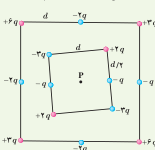
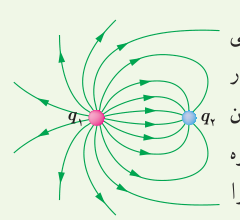
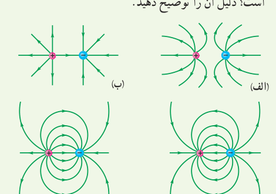
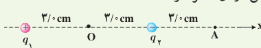
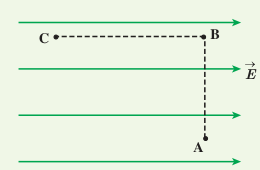
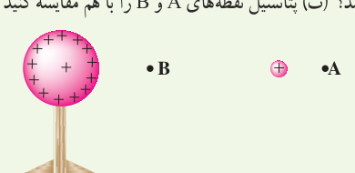

**۱۱** در یک میدان الکتریکی یکنواخت به بزرگی $4/9\times10^5\,\mathrm{N/C}$ که جهت آن قائم و رو به پایین است، ذرۀ بارداری به جرم $2/0\,\mathrm g$ معلق و به حال سکون قرار دارد. اگر $g=9/8\,\mathrm{N/kg}$ باشد، اندازه و نوع بار الکتریکی ذره را مشخص کنید.

**۱۲** شکل زیر دو آرایۀ مربعی از ذرات باردار را نشان می‌دهد. مربع‌ها که در نقطۀ P هم‌مرکزند، هم‌ردیف نیستند. ذره‌ها روی محیط مربع به فاصلۀ $d$ یا $d/2$ از هم قرار گرفته‌اند. بزرگی و جهت میدان الکتریکی برآیند در نقطۀ P چیست؟

**۱۳** خطوط میدان الکتریکی برای دو کرۀ رسانای باردار کوچک در شکل روبه‌رو نشان داده شده است. نوع بار هر کره را تعیین کرده و اندازۀ آنها را مقایسه کنید.

**۱۴** در شکل‌های زیر، اندازۀ دو بار، یکسان ولی علامت آنها مخالف هم است. کدام آرایش‌های خطوط میدان نادرست است؟ دلیل آن را توضیح دهید.

**۱۵** دو بار الکتریکی نقطه‌ای غیرهمنام $q_1=+1/0\,\mathrm{nC}$ و $q_2=-1/0\,\mathrm{nC}$ مطابق شکل زیر به فاصلۀ $6/0\,\mathrm{cm}$ از یکدیگر قرار دارند. الف) جهت و اندازۀ میدان الکتریکی را در نقطه‌های O و A به‌دست آورید. ب) آیا روی محور، نقطه‌ای وجود دارد که میدان الکتریکی خالص در آن صفر شود؟

## ۱ـ۷ و ۱ـ۸ انرژی پتانسیل الکتریکی و پتانسیل الکتریکی

**۱۶** مطابق شکل زیر، بار $q=+50\,\mathrm{nC}$ را در میدان الکتریکی یکنواخت $8/0\times10^5\,\mathrm{N/C}$ نخست از نقطۀ A تا نقطۀ B و سپس تا نقطۀ C جابه‌جا می‌کنیم. اگر $AB=0/20\,\mathrm m$ و $BC=0/40\,\mathrm m$ باشد، مطلوب است: الف) نیروی الکتریکی وارد بر بار $q$، ب) کاری که نیروی الکتریکی در این جابه‌جایی انجام می‌دهد، پ) تغییر انرژی پتانسیل الکتریکی بار $q$ در این جابه‌جایی.

**۱۷** در شکل زیر ذرۀ باردار مثبت و کوچکی را از حالت سکون، از نقطۀ A به سمت کرۀ باردار که روی پایۀ عایقی قرار دارد، نزدیک می‌کنیم و در نقطۀ B قرار می‌دهیم. الف) در این جابه‌جایی، کار نیروی الکتریکی مثبت است یا منفی؟ ب) کاری که ما در این جابه‌جایی انجام می‌دهیم مثبت است یا منفی؟ پ) انرژی پتانسیل ذرۀ باردار در این جابه‌جایی چگونه تغییر می‌کند؟ ت) پتانسیل نقطه‌های A و B را با هم مقایسه کنید.

