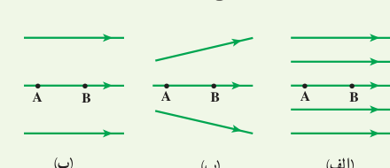
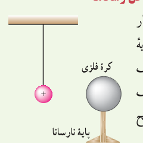

**۱۸** شکل زیر سه آرایش خطوط میدان الکتریکی را نشان می‌دهد. در هر آرایش، یک پروتون از حالت سکون در نقطۀ A رها می‌شود و سپس توسط میدان الکتریکی تا نقطۀ B شتاب می‌گیرد. نقطه‌های A و B در هر سه آرایش در فاصله‌های یکسانی از هم قرار دارند. در کدام شکل سرعت پروتون در نقطۀ B بیشتر است؟ توضیح دهید.

**۱۹** دو صفحۀ رسانا با فاصلۀ $2/00\,\mathrm{cm}$ را موازی یکدیگر قرار می‌دهیم و آنها را به اختلاف پتانسیل $100\,\mathrm V$ وصل می‌کنیم. درنتیجه، یکی از صفحه‌ها به‌طور منفی و دیگری به‌طور مثبت باردار می‌شوند و میان دو صفحه میدان الکتریکی یکنواختی به‌وجود می‌آید. اندازۀ این میدان الکتریکی را حساب کنید و با توجه به جهت خطوط میدان الکتریکی در فضای بین دو صفحه توضیح دهید که کدام‌یک از دو صفحه پتانسیل الکتریکی بیشتری دارند.

**۲۰** بار الکتریکی $q=-40\,\mathrm{nC}$ از نقطه‌ای با پتانسیل الکتریکی $V_1=-40\,\mathrm V$ تا نقطه‌ای با پتانسیل $V_2=-10\,\mathrm V$ آزادانه جابه‌جا می‌شود. الف) انرژی پتانسیل الکتریکی بار $q$ چه اندازه و چگونه تغییر می‌کند؟ ب) با توجه به قانون پایستگی انرژی، در مورد چگونگی تبدیل انرژی بار $q$ در این جابه‌جایی توضیح دهید.

## ۱ـ۹ میدان الکتریکی در داخل رساناها

**۲۱** یک کرۀ فلزی بدون بار الکتریکی را که روی پایۀ نارسانایی قرار دارد، به آونگ بارداری نزدیک می‌کنیم. با ذکر دلیل توضیح دهید که چه اتفاقی می‌افتد.

**۲۲** یک صفحۀ پلاستیکی باردار (طلق یا ورق باردار) را به براده‌های ریز آلومینیمی بدون بار نزدیک می‌کنیم. مشاهده می‌شود که براده‌ها به طرف صفحۀ پلاستیکی جذب می‌شوند. علت این پدیده را توضیح دهید.

**۲۳** وقتی ماهواره‌ای به دور زمین می‌چرخد بر اثر عبور از فضای اطراف زمین باردار می‌شود. این بارها ممکن است موجب آسیب‌رساندن به قطعات الکترونیکی ماهواره شود. فرض کنید ماهواره‌ای در اثر عبور از یکی از لایه‌های جو دارای بار الکتریکی $q=2/0\times10^{-9}\,\mathrm C$ شود. این ماهواره، مکعبی به ضلع $40\,\mathrm{cm}$ است. چگالی سطحی بار الکتریکی روی سطح این ماهواره را محاسبه کنید. (از تجمع بار بر روی لبه‌ها چشم‌پوشی شود.)

## ۱ـ۱۰ خازن

**۲۴** اگر ساختمان یک خازن را تغییر ندهیم، در هر یک از شرایط زیر ظرفیت خازن چگونه تغییر می‌کند؟ الف) بار آن دو برابر شود. ب) اختلاف پتانسیل میان صفحه‌های آن سه برابر شود.

**۲۵** اختلاف پتانسیل بین دو صفحۀ یک خازن را از ۲۸ ولت به ۴۰ ولت افزایش می‌دهیم. اگر با این کار ۱۵ میکروکولن بر بار ذخیره‌شده در خازن افزوده شود، ظرفیت خازن را حساب کنید.
