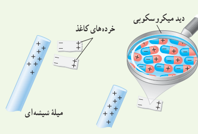
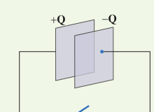

## ۱ـ۱۱ خازن با دی‌الکتریک

**۲۶** بادکنک باردار شکل زیر را به آب نزدیک کرده‌ایم. توضیح دهید چرا آب به‌جای اینکه به‌طور قائم فرو ریزد، خمیده می‌شود؟

**۲۷** با توجه به شکل زیر توضیح دهید چرا یک میلۀ باردار، خرده‌های کاغذ را می‌رباید؟

**۲۸** ظرفیت یک خازن تخت با فاصلۀ صفحات $1/0\,\mathrm{mm}$ که بین صفحه‌های آن هوا قرار دارد، برابر $1/0\,\mathrm F$ است. مساحت صفحه‌های این خازن چقدر است؟ از این مسئله چه نتیجه‌ای می‌گیرید؟

**۲۹** یک خازن تخت به یک باتری بسته شده است تا باردار شود. پس از مدتی، درحالی که باتری همچنان به خازن متصل است، فاصلۀ بین صفحه‌های خازن را دو برابر می‌کنیم. کدام‌یک از موارد زیر درست است؟ الف) میدان الکتریکی میان صفحه‌ها نصف می‌شود. ب) اختلاف پتانسیل میان صفحه‌ها نصف می‌شود. پ) ظرفیت خازن دو برابر می‌شود. ت) بار روی صفحه‌ها تغییر نمی‌کند.

**۳۰** مساحت هریک از صفحه‌های خازن تختی، $1/00\,\mathrm{m^2}$ و فاصلۀ دو صفحه از هم، $0/500\,\mathrm{mm}$ است. عایقی با ثابت دی‌الکتریک ۴/۹ بین دو صفحه قرار داده شده است. ظرفیت خازن را تعیین کنید.

## ۱ـ۱۲ انرژی خازن

**۳۱** دو صفحۀ خازن تخت بارداری را همانند شکل با بستن کلید به هم وصل می‌کنیم، در نتیجه جرقه‌ای زده می‌شود. حال اگر دوباره صفحات را به همان اندازه باردار کنیم ولی فاصلۀ آنها را دو برابر کنیم و سپس دو صفحه را به هم وصل کنیم، آیا جرقۀ حاصل بزرگ‌تر از قبل می‌شود، یا کوچک‌تر و یا تغییری نمی‌کند؟ توضیح دهید.

**۳۲** ظرفیت خازنی ۱۲ میکروفاراد و بار الکتریکی آن $q$ است. اگر $+3/0\,\mathrm{mC}$ بار الکتریکی از صفحۀ منفی به صفحۀ مثبت منتقل شود، انرژی ذخیره‌شده در خازن به اندازۀ $8/0\,\mathrm J$ زیاد می‌شود. $q$ را محاسبه کنید.
