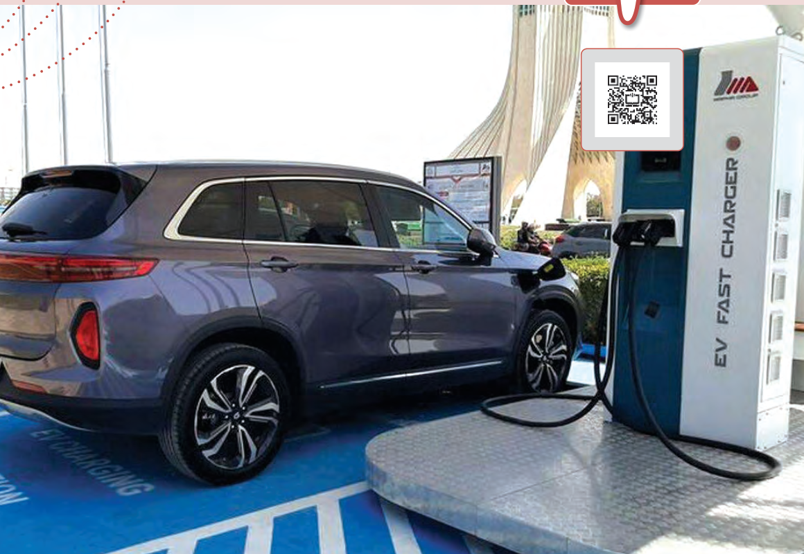

# فصل ۲: جریان الکتریکی و مدارهای جریان مستقیم

پژوهش‌های زیادی دربارۀ بهبود کیفیت باتری خودروهای الکتریکی و هیبریدی (که در آنها از موتورهای درون‌سوز بنزینی و موتورهای الکتریکی با هم استفاده می‌شود) در حال انجام است. یک نوع از این باتری‌ها، باتری لیتیمی است که یکی از قطب‌های آن لیتیم و قطب دیگر آن کربن است. مسافتی که یک خودروی الکتریکی با هر بار شارژ شدن طی می‌کند، عامل مهمی است. برخلاف خودروهای بنزینی که سوخت‌گیری آنها چند دقیقه‌ای بیشتر طول نمی‌کشد، شارژ کردن باتری این خودروها نسبتاً طولانی است. از همین رو دانشمندان در تلاش‌اند زمان شارژ این باتری‌ها را کاهش دهند. یکی از این راه‌ها استفاده از منبع‌های نیروی محرکه است که از ابرخازن‌ها استفاده می‌کنند. با استفاده از این فناوری ممکن است بتوان خودروهای الکتریکی را در مدت کوتاهی شارژ کرد.
