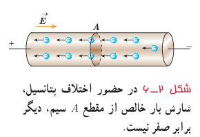
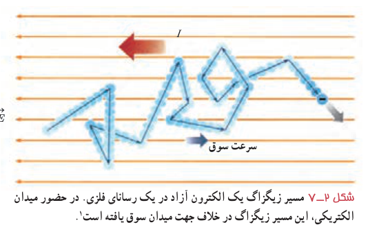

جریان الکتریکی در رسانا می‌شود (شکل ۲ـ۷). اندازۀ سرعت سوق در یک رسانای فلزی در مقایسه با تندی کاتوره‌ای الکترون‌های آزاد، بسیار کم و مثلاً در سیم‌های مسی از مرتبۀ بزرگی $10^{-5}\,\mathrm{m/s}$ یا $10^{-4}\,\mathrm{m/s}$ است. توجه کنید که جهت قراردادی جریان الکتریکی $I$، برخلاف جهت سوق الکترون‌هاست.

شکل ۲ـ۶ در حضور اختلاف پتانسیل، شارش بار خالص از مقطع A سیم، دیگر برابر صفر نیست.

شکل ۲ـ۷ مسیر زیگزاگ یک الکترون آزاد در یک رسانای فلزی. در حضور میدان الکتریکی، این مسیر زیگزاگ در خلاف جهت میدان سوق یافته است.¹

### فعالیت ۲ـ۱

سرعت سوق الکترون‌های آزاد در یک رسانا می‌تواند به کندی سرعت حرکت یک حلزون باشد. اگر سرعت سوق الکترون‌ها این‌قدر کم است، پس چرا وقتی کلید برق را می‌زنیم چراغ‌های خانه به سرعت روشن می‌شوند؟ (راهنمایی: شیلنگ شفافی را در نظر بگیرید. وقتی شیر را باز می‌کنید، هنگامی که شیلنگ پر از آب است، آب بلافاصله از سر دیگر شیلنگ جاری می‌شود؛ ولی اگر لکه‌ای رنگی را درون آب چکانده باشیم، می‌بینیم این لکۀ رنگی به آهستگی در آب حرکت می‌کند.)

اکنون می‌خواهیم تعریفی برای جریان الکتریکی در یک رسانا ارائه کنیم. فرض کنید بار خالص $\Delta q$ در بازۀ زمانی $\Delta t$ از مقطعی از رسانا می‌گذرد. نسبت $\Delta q/\Delta t$ را **جریان الکتریکی متوسط** می‌گویند. اگر این آهنگ ثابت باشد، جریان برابر است با

$$I=\frac{\Delta q}{\Delta t}\tag{2-1}$$

در رابطۀ ۲ـ۱ بار الکتریکی ($\Delta q$) برحسب کولن (C)، مدت زمان ($\Delta t$) برحسب ثانیه (s) و جریان ($I$) برحسب آمپر (A) است. برخی از مقادیر تقریبی جریان‌های متداول عبارت‌اند از ۱ A برای لامپ حبابی ۲۰۰ W، ۲۰۰ A برای استارت خودرو، ۱ mA برای تأمین انرژی نمایشگر گوشی همراه، ۱ nA برای جریان نورون‌های مغزی، ۱۰ kA در یک بورش آذرخش نوعی، و ۱ GA در بادهای خورشیدی.²

در این فصل با جریان‌های الکتریکی سروکار داریم که در آن جهت جریان با زمان تغییر نمی‌کند و مقدار جریان نیز ثابت می‌ماند. این نوع جریان، نمونه‌ای از جریان مستقیم³ است.

### آندره ماری آمپر (۱۷۷۵–۱۸۳۶م)

آندره ماری آمپر در حومۀ شهر لیون فرانسه به دنیا آمد. در کودکی و نوجوانی عشق و علاقۀ فراوانی به ریاضیات داشت و پیوسته اطلاعاتش در زمینۀ علوم ریاضی را تکمیل می‌کرد. سرانجام به سبب نوشتن مقاله‌ای که در مورد سرگرمی‌های ریاضی که در آن مسئله‌ای را حل کرده بود و ذهن دانشمندان را مدت‌ها مشغول کرده بود، مورد توجه ریاضی‌دان‌ها و دانشمندان قرار گرفت. دو اخترشناس و ریاضی‌دان فرانسوی به نام‌های ژان دلامبر و ژوزف لالاند که تحت تأثیر نبوغ و استعداد آمپر قرار گرفته بودند به او پیشنهاد کردند که به‌عنوان معلم ریاضی و نجوم در مدرسۀ لیون تدریس کند. او مدتی در مدرسۀ لیون تدریس کرد و در سال ۱۸۰۵ به پاریس سفر کرد تا در کالج پلی‌تکنیک مشغول به کار شود. در سال ۱۸۰۹ به سمت استاد ریاضی و مکانیک این کالج برگزیده شد. در سال ۱۸۱۹ دانشمند دانمارکی، یوهان اورستد کشف کرد که عقربۀ مغناطیسی در اثر عبور جریان از یک سیم رسانا منحرف می‌شود. آمپر با تکمیل آزمایش او، تأثیر دو سیم رسانای حامل جریان بر یکدیگر را بررسی کرد و نتیجه گرفت وقتی جهت جریان در رساناها یکسان باشد یکدیگر را جذب می‌کنند و چنانچه جهت جریان‌ها برعکس باشند همدیگر را دفع می‌کنند. خلاصه‌ای از این تجربیات بعدها تحت عنوان کتابی به نام «مغناطیس و الکتریسیته» از آمپر به چاپ رسید. آمپر از دانشمندانی بود که خدمات بزرگی به جهان علم کرد و به همین خاطر برای قدردانی از زحمات او دانشمندان، یکای جریان را به نام آمپر نام‌گذاری کردند.

۱ـ در واقع، هر بخش از مسیر زیگزاگی اندکی خمیده است که در شکل برای سادگی نشان داده نشده است.  
۲ـ به‌خاطر سپردن این مقادیر ضروری ندارد.  
۳ـ Direct Current (DC)
