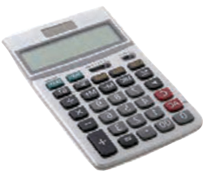
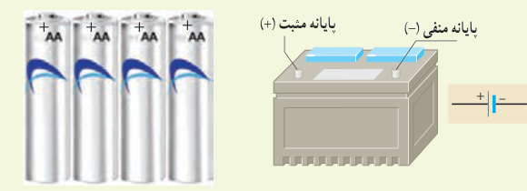

### مثال ۲ـ۱

ولتاژ باتری یک نوع ماشین‌حساب ۳/۰ V است. وقتی ماشین‌حساب روشن است، این باتری باعث عبور جریان $0/17\,\mathrm{mA}$ در آن می‌شود. اگر این ماشین‌حساب یک ساعت روشن باشد: الف) در این مدت چه مقدار بار از مدار می‌گذرد؟ ب) باتری چقدر انرژی به مدار ماشین‌حساب می‌دهد؟

**پاسخ:** الف) باری که در یک ساعت از مدار می‌گذرد، با استفاده از رابطۀ ۲ـ۱ برابر است با

$$\Delta q=I(\Delta t)=(0/17\times10^{-3}\,\mathrm A)(3/6\times10^3\,\mathrm s)=0/61\,\mathrm C$$

ب) انرژی‌ای که باتری به مدار می‌دهد، بنا به رابطۀ ۱ـ۱۳ ($W_{\text{خارجی}}=q\Delta V$) چنین می‌شود:

$$\text{انرژی داده شده به مدار}=q\Delta V=(0/61\,\mathrm C)(3/0\,\mathrm V)=1/8\,\mathrm J$$

### تمرین ۲ـ۱

در رابطۀ $\Delta q=I(\Delta t)$ اگر $I$ برحسب آمپر و $\Delta t$ برحسب ساعت باشند، یکای $\Delta q$، آمپر ـ ساعت می‌شود. باتری خودروها با آمپر ـ ساعت (Ah) و باتری گوشی‌های همراه با میلی‌آمپر ـ ساعت (mAh) مشخص می‌شود. هرچه آمپر ـ ساعت یک باتری بیشتر باشد حداکثر باری که باتری می‌تواند از مدار عبور دهد تا به‌طور ایمن تخلیه شود، بیشتر است.

الف) باتری استاندارد خودرویی، ۵۰ Ah است. اگر این باتری جریان متوسط ۵/۰ A را فراهم سازد، چقدر طول می‌کشد تا خالی شود؟

ب) روی یک باتری قلمی مقدار ۱۰۰۰ mAh نوشته شده است. اگر این باتری جریان متوسط $100\,\mu\mathrm A$ را فراهم سازد، چه مدت طول می‌کشد تا خالی شود؟

### خوب است بدانید: یون‌رانی¹

برای درمان التهاب سه روش وجود دارد. روش نخست که بدون درد است، خوردن دارو است. در این روش مقدار کمی دارو، از مرتبۀ $1\,\mu\mathrm g$، به بافت آسیب‌دیده می‌رسد. روش دوم تزریق آمپول است. این روش دردناک است، ولی می‌تواند داروی زیادی، از مرتبۀ $10\,\mathrm{mg}$ را به بافت آسیب‌دیده برساند، یعنی ۱۰۰۰۰ برابر بیش از روش خوردن دارو. اما از دهۀ ۹۰ میلادی روش سومی نیز مطرح شده است که بدون درد است، ولی می‌تواند مقدار دارویی از مرتبۀ $100\,\mu\mathrm g$ را به بافت آسیب‌دیده برساند. این روش که موسوم به یون‌رانی است، دارو را با استفاده از جریان‌های الکتریکی بسیار ضعیف به بافت آسیب‌دیده می‌رساند. یک وسیلۀ یون‌رانی شامل یک باتری و دو الکترود است (و نیز برخی مدارهای الکترونیکی که پرستار را قادر می‌سازد که بزرگی جریان اعمال شده را کنترل کند). داروی ضد التهاب (معمولاً دگزامتازون²) را به محل التهاب مالیده و الکترود منفی را روی آن

۱ـ Iontophoresis  ۲ـ Dexamethasone
