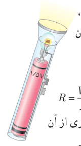
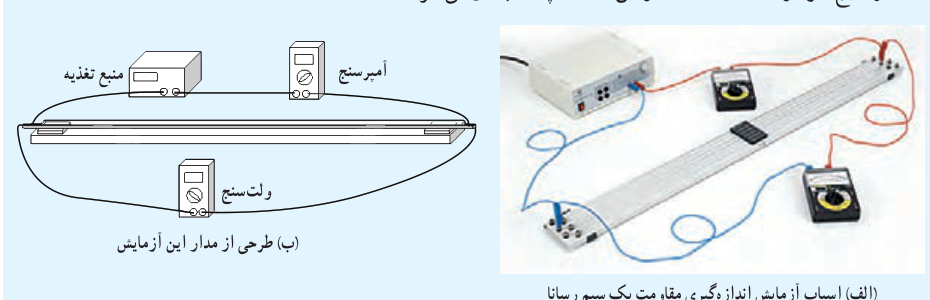

### مثال ۲ـ۲

یک لامپ چراغ‌قوۀ کوچک از یک باتری ۱/۵ V، جریانی برابر $0/30\,\mathrm A$ می‌کشد. با فرض آنکه رشتۀ لامپ، یک رسانای اهمی باشد، الف) مقاومت آن چقدر است؟ ب) اگر باتری ضعیف شود و ولتاژ به ۱/۲ V افت کند، جریان چقدر می‌شود؟ از تغییر مقاومت رشتۀ لامپ در اثر تغییر دما چشم‌پوشی می‌شود.

**پاسخ:** الف) با استفاده از رابطۀ ۲ـ۲ برای مقاومت رشتۀ لامپ داریم:

$$R=\frac VI=\frac{1/5\,\mathrm V}{0/30\,\mathrm A}=5/0\,\Omega$$

ب) دوباره از رابطۀ ۲ـ۲ استفاده می‌کنیم. با توجه به اینکه اکنون مقاومت رشتۀ لامپ را داریم، جریان عبوری از آن چنین می‌شود:

$$I=\frac VR=\frac{1/2\,\mathrm V}{5/0\,\Omega}=0/24\,\mathrm A$$

## ۲ـ۳ عوامل مؤثر بر مقاومت الکتریکی

در بخش قبل پیش‌بینی کردیم که مقاومت الکتریکی یک سیم رسانا به طول و سطح مقطع آن و نیز ترکیب و ساختار آن بستگی دارد. در اینجا می‌خواهیم با تدارک آزمایشی این پیش‌بینی خود را بیازماییم.

### فعالیت ۲ـ۲

اسباب آزمایشی را شامل یک منبع تغذیه، آمپرسنج، ولت‌سنج، سیم‌های رابط و قطعه سیم‌هایی که می‌خواهیم مقاومت آنها را به‌دست آوریم، مطابق شکل داده‌شده سوار کنید. آزمایش شامل سه مرحله است.

۱ـ قطعه سیم‌هایی از جنس یکسان، مثلاً کنستانتان (یا نیکروم) با قطر برابر ولی طول‌های متفاوت را در مدار قرار دهید و با استفاده از تعریف مقاومت، مقاومت هر کدام از سیم‌ها را با استفاده از عددی که آمپرسنج و ولت‌سنج نشان می‌دهند محاسبه و نتایج خود را در جدولی ثبت کنید. به نظر شما چه رابطه‌ای بین مقاومت سیم‌ها و طول آنها وجود دارد؟

۲ـ آزمایش را با سیم‌هایی از جنس یکسان با طول برابر، ولی قطرهای متفاوت انجام دهید و نتایج خود را در جدولی ثبت کنید. به نظر شما چه رابطه‌ای بین مقاومت سیم‌ها و سطح مقطع آنها وجود دارد؟

۳ـ آزمایش را با دو قطعه سیم هم‌طول و با قطر یکسان انجام دهید که این بار جنس یکی از آنها کنستانتان و دیگری نیکروم است و نتایج خود را یادداشت کنید. از این فعالیت چه نتیجه‌ای می‌گیرید؟

الف) اسباب آزمایش اندازه‌گیری مقاومت یک سیم رسانا. ب) طرحی از مدار این آزمایش.
