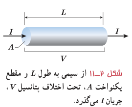
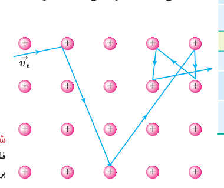

با انجام فعالیت بالا درمی‌یابیم که مقاومت جسم در دمای ثابت به طول، مساحت مقطع، و جنس آن بستگی دارد. این آزمایش‌ها که با محاسبات نظری نیز تأیید شده‌اند نشان می‌دهد اگر سطح مقطع جسم در تمام طول آن یکسان باشد (شکل ۲ـ۱۱)، مقاومت آن از رابطۀ زیر به‌دست می‌آید:

$$R=\rho\frac LA\tag{2-3}$$

که در آن طول رسانا ($L$) برحسب متر (m)، مساحت مقطع جسم ($A$) برحسب متر مربع ($\mathrm{m^2}$)، و مقاومت جسم ($R$) برحسب اهم ($\Omega$) است، و بنابراین، کمیت $\rho$ که به آن **مقاومت ویژه** گفته می‌شود برحسب اهم ـ متر ($\Omega\cdot\mathrm m$) می‌شود. این بستگی مقاومت به طول و مساحت مقطع جسم را می‌توان با شبیه‌سازی‌های ساده‌ای نیز درک کرد. هرچه جسم بلندتر شود الکترون‌ها هنگام عبور از آن برخوردهای بیشتری با اتم‌ها پیدا می‌کنند. بنابراین، مقاومت الکتریکی جسم بیشتر می‌شود. کوچک‌تر شدن سطح مقطع جسم را نیز می‌توان به کوچک‌تر شدن سطح مقطع لوله‌ای تشبیه کرد که در آن شاره‌ای در جریان است. کوچک‌تر شدن مقطع سبب کاهش عبور شاره می‌شود که به‌معنای افزایش مقاومت در برابر عبور شاره است.

شکل ۲ـ۱۱ از سیمی به طول $L$ و مقطع یکنواخت $A$، تحت اختلاف پتانسیل $V$، جریان $I$ می‌گذرد.

مقاومت ویژۀ یک ماده به ساختار اتمی و دمای آن بستگی دارد. رساناهای الکتریکی خوب مقاومت ویژۀ بسیار کم و عایق‌های خوب مقاومت ویژۀ بسیار زیادی دارند. جدول ۲ـ۲ مقاومت ویژۀ برخی مواد را در دمای ۲۰°C نشان می‌دهد. همان‌طور که این جدول نشان می‌دهد دسته‌ای از مواد مانند ژرمانیم و سیلیسیم نیز وجود دارند که مقاومت ویژۀ آنها بین مقاومت ویژۀ رساناها و نارساناهاست. به این دسته از مواد، **نیم‌رسانا** می‌گویند.

### جدول ۲ـ۲ مقاومت ویژه در دمای ۲۰°C و ضریب دمایی مقاومت ویژۀ برخی از رساناها و نیم‌رساناها

| ماده | مقاومت ویژه $\rho$ (Ω·m) | ضریب دمایی $\alpha$ (K⁻¹) |
|---|---:|---:|
| نقره | $1/6\times10^{-8}$ | $4/1\times10^{-3}$ |
| مس | $1/7\times10^{-8}$ | $4/3\times10^{-3}$ |
| طلا | $2/4\times10^{-8}$ | $3/4\times10^{-3}$ |
| آلومینیم | $2/8\times10^{-8}$ | $4/4\times10^{-3}$ |
| تنگستن | $5/5\times10^{-8}$ | $4/5\times10^{-3}$ |
| آهن | $9/7\times10^{-8}$ | $6/5\times10^{-3}$ |
| پلاتین | $10\times10^{-8}$ | $3/9\times10^{-3}$ |
| سرب | $22\times10^{-8}$ | $4/3\times10^{-3}$ |
| کنستانتان¹ | $44\times10^{-8}$ | $2/0\times10^{-6}$ |
| نیکروم² | $100\times10^{-8}$ | $4/0\times10^{-4}$ |
| گرافیت | $3/5\times10^{-5}$ | $-5\times10^{-4}$ |
| ژرمانیم | ۰/۴۶ | $-5\times10^{-2}$ |
| سیلیسیم خالص | $2/5\times10^3$ | $-7\times10^{-2}$ |
| انواع شیشه | $10^{10}$–$10^{14}$ | — |
| لاستیک سخت | $10^{13}$ | — |
| کوارتز (ذوب‌شده) | $10^{16}$ | — |

**تغییر مقاومت ویژه با دما:** اگر یک رسانای فلزی داشته باشیم، با افزایش دمای آن، تعداد حامل‌های بار (اینجا الکترون‌های آزاد) تقریباً ثابت می‌ماند، ولی ارتعاشات کاتوره‌ای اتم‌ها و یون‌های آن افزایش می‌یابد. این عامل موجب افزایش برخورد حامل‌های بار با شبکۀ اتمی رسانای فلزی می‌شود (شکل ۲ـ۱۲) و به این ترتیب، مقاومت رسانا در برابر

شکل ۲ـ۱۲ حرکت الکترون در داخل شبکۀ بلوری فلز. با افزایش دما، ارتعاشات شبکه و در نتیجه برخورد الکترون‌ها با شبکه افزایش می‌یابد.

۱ـ ۶۰ درصد مس، ۴۰ درصد نیکل  
۲ـ ۵۹ درصد نیکل، ۲۳ درصد آهن، ۱۶ درصد کروم و ...
