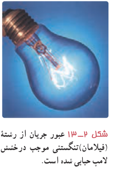
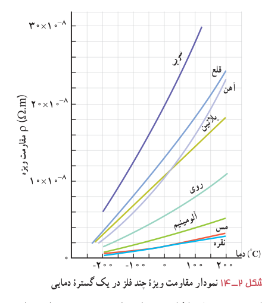

عبور جریان زیاد می‌شود؛ مثلاً در یک لامپ رشته‌ای حبابی (شکل ۲ـ۱۳) مقاومت آن با افزایش دمای رشته به‌شدت افزایش می‌یابد. آزمایش نشان می‌دهد که مقاومت ویژۀ فلزات در یک گستره دمایی نسبتاً بزرگ، با دما تقریباً به‌طور خطی تغییر می‌کند. شکل ۲ـ۱۴، مقاومت ویژۀ برخی از فلزات را در محدودۀ‌ای از دما نشان می‌دهد. یک تقریب تجربی خوب که برای اغلب مقاصد، به حد کافی مناسب است توسط رابطۀ زیر داده می‌شود:

$$\rho=\rho_0[1+\alpha(T-T_0)]\tag{2-4}$$

که در آن $T_0$ دمای مرجع و $\rho_0$ مقاومت ویژه در آن دماست (معمولاً $T_0$ را دمای اتاق $T_0=20^\circ\mathrm C=293\,\mathrm K$ می‌گیرند) و $\alpha$ ثابتی موسوم به ضریب دمایی مقاومت ویژه و $T$ دمای رسانا (برحسب °C یا K) است. یکای $\alpha$ در این رابطه $\mathrm{K^{-1}}$ (یا $1/^\circ\mathrm C$) است.

شکل ۲ـ۱۳ عبور جریان از رشتۀ (فیلامان) تنگستنی موجب درخشش لامپ حبابی شده است.

اگر یک نیم‌رسانا داشته باشیم، در دماهای پایین تعداد حامل‌های بار¹ ناچیز است و نیم‌رسانا مانند یک نارسانا رفتار می‌کند. با افزایش دما، نشان داده می‌شود بر تعداد این حامل‌های بار افزوده می‌گردد. گرچه با افزایش دما تعداد برخوردهای کاتوره‌ای حامل‌های بار با شبکۀ اتمی افزایش می‌یابد، اما تأثیر افزایش تعداد حامل‌های بار بیشتر از افزایش این برخوردهای کاتوره‌ای است. به این ترتیب، مقاومت ویژۀ نیم‌رساناها با افزایش دما کاهش می‌یابد. ضریب دمایی مقاومت ویژۀ برخی از مواد در جدول ۲ـ۲ داده شده است. همان‌طور که مشاهده می‌کنید این ضریب برای نیم‌رساناها منفی است که به معنی کاهش مقاومت ویژۀ این مواد با افزایش دما است.

شکل ۲ـ۱۴ نمودار مقاومت ویژۀ چند فلز در یک گستره دمایی.

در برخی مواد، مانند جیوه و قلع با کاهش دما، مقاومت ویژه در دمای خاصی به‌صورت ناگهانی به صفر افت می‌کند و در دماهای پایین‌تر، همچنان صفر می‌ماند. این پدیده را **ابررسانایی** می‌گویند.

۱ـ در نیم‌رساناها علاوه بر الکترون‌های آزاد، حامل‌های بار مثبتی نیز وجود دارند که بررسی آنها خارج از سطح این کتاب است.
