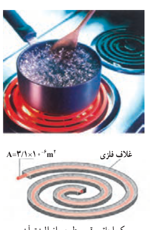
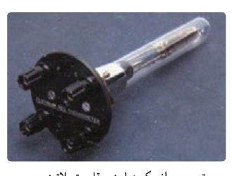

### مثال ۲ـ۳

شکل روبه‌رو، المنت یک اجاق برقی را نشان می‌دهد. این المنت شامل سیمی به طول $1/1\,\mathrm m$ و سطح مقطع $3/1\times10^{-6}\,\mathrm{m^2}$ است که داخل مادۀ عایقی قرار گرفته است که خود، درون یک غلاف فلزی است. با عبور جریان، المنت داغ می‌شود. مقاومت ویژۀ مادۀ سازندۀ سیم در دمای $T_0=32^\circ\mathrm C$ برابر با $\rho_0=6/8\times10^{-5}\,\Omega\cdot\mathrm m$ است و ضریب دمایی مقاومت ویژۀ آن $\alpha=2/0\times10^{-3}\,\mathrm{K^{-1}}$ است. مقاومت سیم در دمای $42^\circ\mathrm C$ چقدر است؟

**پاسخ:** مقاومت ویژه $\rho$ را از رابطۀ $\rho=\rho_0[1+\alpha(T-T_0)]$ حساب می‌کنیم:

$$\rho=(6/8\times10^{-5}\,\Omega\cdot\mathrm m)[1+(2/0\times10^{-3}\,\mathrm{K^{-1}})(10\,\mathrm K)]=8/2\times10^{-5}\,\Omega\cdot\mathrm m$$

حال از رابطۀ ۲ـ۳ مقاومت سیم در دمای $42^\circ\mathrm C$ برابر است با

$$R=\rho\frac LA=(8/2\times10^{-5}\,\Omega\cdot\mathrm m)\frac{1/1\,\mathrm m}{3/1\times10^{-6}\,\mathrm{m^2}}=29\,\Omega$$

### مثال ۲ـ۴: دماسنج مقاومت پلاتینی

همان‌طور که در کتاب فیزیک ۱ دیدید دماسنج مقاومت پلاتینی یکی از سه دماسنج معیار برای اندازه‌گیری دماست. از دماسنج مقاومت پلاتینی می‌توان برای اندازه‌گیری دقیق دما در گستره دمایی حدوداً از ۱۴ K تا ۱۲۳۵ K استفاده کرد. اساس کار دماسنج‌های مقاومت پلاتینی مبتنی بر تغییر مقاومت الکتریکی با دماست. در این دماسنج‌ها از پلاتین استفاده می‌کنند که تقریباً دچار خوردگی نمی‌شود و نقطۀ ذوب بالایی دارد.

فرض کنید در دمای $20/0^\circ\mathrm C$ مقاومت پلاتین یک دماسنج برابر با $164\,\Omega$ باشد. وقتی این دماسنج در محلول خاصی قرار گیرد، مقاومت آن $187\,\Omega$ می‌شود. دمای این محلول چقدر است؟ (مقدار دقیق $\alpha$ برای پلاتین برابر $3/92\times10^{-3}\,^\circ\mathrm C^{-1}$ است.)

**پاسخ:** چون مقاومت $R$ رابطۀ مستقیمی با مقاومت ویژه $\rho$ دارد ($R=\rho L/A$)، آن‌گاه از رابطۀ ۲ـ۴ نتیجه می‌گیریم:¹

$$R=R_0[1+\alpha(T-T_0)]$$

که در آن $R_0=\rho_0L/A$ مقاومت سیم در دمای $T_0=20/0^\circ\mathrm C$ است. با جایگذاری مقادیر معلوم در معادلۀ بالا خواهیم داشت:

$$187\,\Omega=(164\,\Omega)[1+(3/92\times10^{-3}\,^\circ\mathrm C^{-1})(T-20/0^\circ\mathrm C)]\Rightarrow T=55/8^\circ\mathrm C$$

۱ـ از افزایش طول و مساحت سیم در اثر افزایش دما صرف‌نظر می‌شود.
