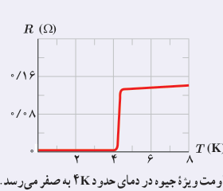

### خوب است بدانید: ابررسانایی¹

در اوایل قرن بیستم میلادی پدیدۀ شگفت‌انگیزی برای برخی از فلزات در دمای خیلی پایین مشاهده شد و دریافتند با کاهش دما، مقاومت ویژۀ این فلزات در دمای خاصی موسوم به دمای بحرانی²، ناگهان به صفر افت می‌کند و از آن دما پایین‌تر همچنان صفر باقی می‌ماند. به این پدیده ابررسانایی می‌گویند. فیزیک‌دان هلندی کامرلینگ اونز³ در سال ۱۹۱۱ برای نخستین بار، این پدیده را برای جیوه مشاهده کرد و دریافت که در دمای حدود ۴ K مقاومت ویژۀ جیوه به‌طور ناگهانی صفر می‌شود (شکل را ببینید). دمای بحرانی برای فلزات ابررسانای مختلف، متفاوت است، ولی برای اغلب آنها نزدیک به صفر کلوین است. مثلاً همان‌طور که جدول روبه‌رو نشان می‌دهد این دما برای آلومینیم ۱/۱۷۵ K و برای قلع ۳/۷۲۱ K است. البته در سال ۱۹۸۶ میلادی در یک نمونۀ غیر فلزی سرامیک که از باریم، لانتانیم، مس و اکسیژن ساخته شده بود این پدیده در دمای ۳۵ K مشاهده شد. در اوایل ۱۹۸۷ میلادی فیزیک‌دان‌ها سرامیک دیگری با دمای بحرانی ۹۸ K و در سال ۱۹۸۸ میلادی سرامیکی با دمای بحرانی ۱۲۵ K ساختند.

مقاومت ویژۀ جیوه در دمای حدود ۴ K به صفر می‌رسد.

| عنصر | دمای بحرانی (K) |
|---|---:|
| تنگستن | ۰/۰۱۵۴ |
| بریلیم | ۰/۰۲۶ |
| تیتانیم | ۰/۳۹ |
| کادمیم | ۰/۵۲ |
| اُسمیم | ۰/۶۵۵ |
| مولیبدن | ۰/۹۱۶ |
| گالیم | ۱/۰۸۳۳ |
| آلومینیم | ۱/۱۷۵ |
| پروتاکتینیم | ۱/۴ |
| ایندیم | ۳/۴۰۵ |
| قلع | ۳/۷۲۱ |
| جیوه | ۴/۱۵۴ |
| تانتال | ۴/۴۷ |
| سرب | ۷/۲۳ |
| نیوبیم | ۹/۲۵ |

برای اینکه به درکی از پدیدۀ ابررسانایی برسید شارش یک مایع معمولی با چسبندگی ناچیز را در یک لوله تصور کنید. اگر از چنین مایعی استفاده کنید، دیگر نیاز نیست برای تداوم شارش مایع از یک منبع نیروی محرکۀ شاره استفاده کنید؛ زیرا اگر اصطکاکی نباشد برای ادامۀ حرکت یکنواخت نیاز به هیچ نیروی خارجی‌ای نخواهد بود. مثلاً اگر این شاره را در لولۀ دایره‌ای با تکانی سریع به حرکت اندازیم، شاره با وجود اینکه فشار در تمام نقاط لوله یکسان است، به مدت نامحدودی در لوله جریان خواهد داشت. جالب است که چنین شاره‌ای را به‌دست آورده‌اند. کاپیتزا⁴ فیزیک‌دان روسی در سال ۱۹۳۷ میلادی مشاهده کرد که هلیم مایع اگر تا زیر ۲/۱ K سرد شده باشد، چسبندگی بسیار ناچیزی خواهد داشت و در قیاس با ابررساناها به این هلیم ابرشاره گفته می‌شود. پس شارش مایع بدون چسبندگی، مانند جریان الکتریکی در ابررساناهاست. به همین ترتیب اگر در یک حلقۀ ابررسانا جریان الکتریکی ایجاد کنیم، پس از حذف نیروی محرکۀ الکتریکی جریان متوقف نخواهد شد و برای مدتی طولانی ادامه خواهد یافت. فیزیک‌دانی به نام کالینز⁵ در سال ۱۹۵۶ میلادی توانست جریان ثابتی را در یک حلقۀ ابررسانا به مدت ۲/۵ سال حفظ کند. بنابراین، ابررسانایی اهمیت بالقوۀ زیادی در فناوری دارد؛ زیرا بدان معناست که بار می‌تواند بدون اتلاف انرژی در داخل یک ابررسانا جریان پیدا کند، و کشف مواد سرامیکی که می‌توانند در دمای بالا ابررسانا شوند وعدۀ روزی را می‌دهد که وسایل ابررسانا در دمای اتاق به کار گرفته شوند.

۱ـ Super-Conductivity  ۲ـ Critical Temperature  ۳ـ Kamerlingh Onnes  ۴ـ P. L. Kapitza  ۵ـ T. Collins
