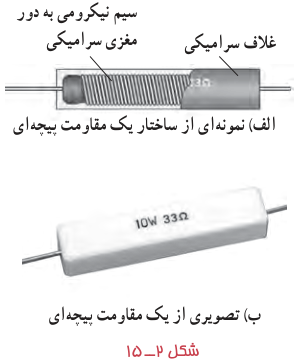
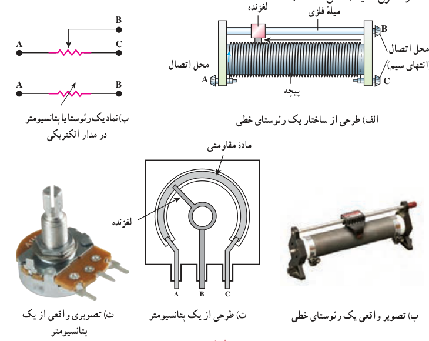

نیکروم¹ یا منگانین² است. شکل ۲ـ۱۵ـ الف نمونه‌ای از ساختار چنین مقاومت‌هایی را نشان می‌دهد. این مقاومت‌ها برای به‌دست آوردن مقاومت‌های پایین بسیار دقیق و همچنین توان‌های بالا ساخته می‌شوند. بیشینۀ توان الکتریکی که این مقاومت‌ها می‌توانند تحمل کنند، بی‌آنکه بسوزند روی آنها نوشته شده است (شکل ۲ـ۱۵ـ ب).

شکل ۲ـ۱۵ الف) نمونه‌ای از ساختار یک مقاومت پیچه‌ای. ب) تصویری از یک مقاومت پیچه‌ای.

یکی از انواع مشهور مقاومت‌های پیچه‌ای، **رئوستا**³ نام دارد که یک نوع مقاومت متغیر است. در مدارهای الکترونیکی وسیله‌ای به نام **پتانسیومتر**⁴ به نوعی همان نقش را انجام می‌دهد. این نوع مقاومت‌ها، متغیرند. یک رئوستا از سیمی با مقاومت ویژۀ نسبتاً زیاد ساخته شده است. در یکی از انواع رئوستا (رئوستای خطی)، این سیم روی استوانه‌ای نارسانا پیچیده شده و با استفاده از دکمه‌ای لغزنده که روی ریلی در بالای استوانه قرار دارد و انتهای آن با سیم در تماس است می‌تواند قسمت دلخواهی از سیم را در مسیر جریان قرار دهد، و بنابراین مقدار مقاومت را تغییر داده و جریان را در مدار کنترل نماید (شکل ۲ـ۱۶).

شکل ۲ـ۱۶ الف) طرحی از ساختار یک رئوستای خطی. ب) نماد یک رئوستا یا پتانسیومتر در مدار الکتریکی. پ) تصویری واقعی از یک رئوستای خطی. ت) طرحی از یک پتانسیومتر. ث) تصویری واقعی از یک پتانسیومتر.

۲ـ **مقاومت‌های ترکیبی**⁵ معمولاً از کربن، برخی نیم‌رساناها، و یا لایه‌های نازک فلزی ساخته شده‌اند. مقاومت‌های ترکیبی را در اندازه‌های خاص استانداردی تولید می‌کنند. مقدار این مقاومت‌ها یا روی آنها نوشته می‌شود، یا عمدتاً به‌صورت کدی رنگی نشان داده می‌شود که با ۳ یا ۴ حلقۀ رنگی روی آنها مشخص شده است (شکل ۲ـ۱۷). هر رنگ، معرف عددی است که در جدول ۲ـ۳

### جدول ۲ـ۳ کد رنگی مقاومت‌ها

| رنگ | عدد | ضریب | تلرانس |
|---|---:|---:|---:|
| سیاه | ۰ | $10^0=1$ | — |
| قهوه‌ای | ۱ | $10^1$ | — |
| قرمز | ۲ | $10^2$ | — |
| نارنجی | ۳ | $10^3$ | — |
| زرد | ۴ | $10^4$ | — |
| سبز | ۵ | $10^5$ | — |
| آبی | ۶ | $10^6$ | — |
| بنفش | ۷ | $10^7$ | — |
| خاکستری | ۸ | $10^8$ | — |
| سفید | ۹ | $10^9$ | — |
| طلایی | — | $10^{-1}$ | ۵٪ |
| نقره‌ای | — | $10^{-2}$ | ۱۰٪ |
| بی‌رنگ | — | — | ۲۰٪ |

۱ـ Nichrome (آلیاژ نیکل و کرم)  ۲ـ Manganin (آلیاژ مس، نیکل و منگنز)  ۳ـ Rheostat  
۴ـ Potentiometer. پتانسیومتر می‌تواند نقش پتانسیل‌سنجی نیز در مدارها داشته باشد که در آن صورت به آن پتانسیل‌سنج گفته می‌شود. این موضوع خارج از موضوع درسی این کتاب است.  
۵ـ composition resistors
