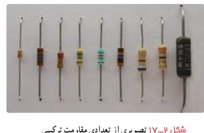
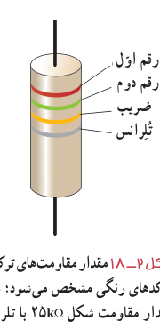
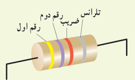
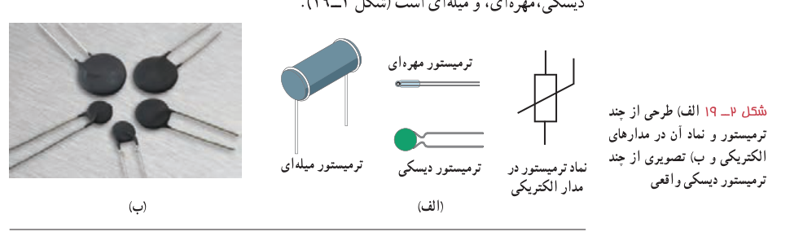

داده شده است. دو حلقۀ اول (از آن طرفی که به یک سر مقاومت نزدیک‌تر است) به ترتیب، رقم اول و رقم دوم مقاومت را نشان می‌دهند. رقم حلقۀ سوم ضریبی است به‌صورت $10^n$ که در ستون سوم جدول مشخص شده است. حلقۀ چهارم یک حلقۀ طلایی یا نقره‌ای رنگ است که **تلرانس**¹ نامیده می‌شود و مقدار مجاز انحراف از مقدار دقیق مقاومت را برحسب درصد مشخص می‌کند (شکل ۲ـ۱۸). نبود نوار چهارم به معنای آن است که تلرانس ۲۰ درصد است. برای خواندن حلقه‌های رنگی، مقاومت را طوری به دست می‌گیریم که حلقۀ تلرانس در سمت راست قرار گیرد و بقیۀ حلقه‌ها را از سمت چپ به راست می‌خوانیم.

شکل ۲ـ۱۷ تصویری از تعدادی مقاومت ترکیبی.

شکل ۲ـ۱۸ مقدار مقاومت‌های ترکیبی با کدهای رنگی مشخص می‌شود؛ مثلاً مقدار مقاومت شکل $25\,\mathrm{k\Omega}$ با تلرانس ۱۰ درصد است.

### تمرین ۲ـ۲

مقدار مقاومت نشان داده شده در شکل، و مقدار مجاز انحراف از مقدار دقیق مقاومت، برحسب اهم چقدر است؟

**مقاومت‌های خاص و دیودها:**

۱ـ **ترمیستور**²: ترمیستور نوعی از مقاومت است که بستگی مقاومت الکتریکی آن به دما با مقاومت‌های الکتریکی معمولی تفاوت دارد. اغلب از ترمیستورها به‌عنوان حسگر دما در مدارهای حساس به دما مانند زنگ خطر آتش و دماپاها و نیز در دماسنج‌ها استفاده می‌شود.

ترمیستورها در ابعاد کوچکی ساخته می‌شوند و شکل‌های متفاوتی دارند که رایج‌ترین آنها دیسکی، مهره‌ای، و میله‌ای است (شکل ۲ـ۱۹).

شکل ۲ـ۱۹ الف) طرحی از چند ترمیستور و نماد آن در مدارهای الکتریکی و ب) تصویری از چند ترمیستور دیسکی واقعی.

۱ـ tolerance  ۲ـ Thermistor، برگرفته از عبارت Thermal Sensitive Resistor به معنای مقاومت حساس به دما.
