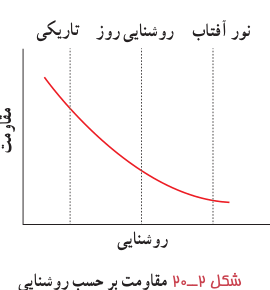
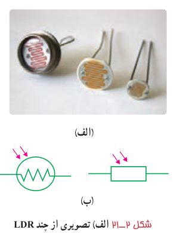
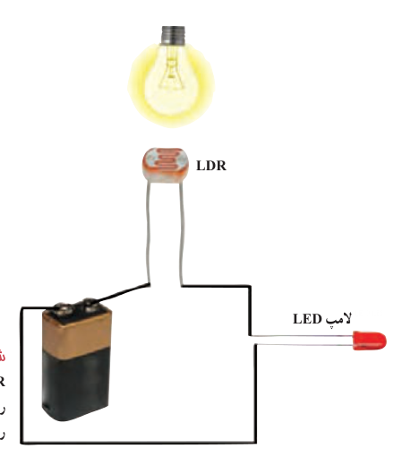

### فعالیت ۲ـ۳

ترمیستورها به دو نوع NTC و PTC تقسیم‌بندی می‌شوند. در مورد ساختار و کارکرد آنها تحقیق کرده و به کلاس گزارش دهید.

۲ـ **مقاومت‌های نوری**¹ (LDR²): مقاومت نوری، نوعی مقاومت است که مقاومت الکتریکی آن به نور تابیده شده به آن بستگی دارد، به‌طوری که با افزایش شدت نور، از مقاومت آن کاسته می‌شود. مثلاً یک LDR نوعی در تاریکی مقاومتی چند مگااهمی دارد، در حالی که در یک نور مناسب، مقاومت آن به چند صد اهم می‌رسد. نوعی از این مقاومت‌ها از جنس نیم‌رسانای خالص، مانند سیلیسیم هستند که با افزایش شدت نور تابیده شده، بر تعداد حامل‌های بار الکتریکی آنها افزوده شده و در نتیجه از مقاومت آنها کاسته می‌شود. مثلاً شکل ۲ـ۲۰ مقاومت الکتریکی چنین LDRهایی را بر حسب روشنایی³ (که با یکای LUX سنجیده می‌شود) نشان می‌دهد. شکل ۲ـ۲۱ـ الف تصویری از چند LDR و شکل ۲ـ۲۱ـ ب دو نماد این مقاومت‌ها در مدارهای الکتریکی را نشان می‌دهد.

شکل ۲ـ۲۰ مقاومت برحسب روشنایی برای یک LDR نوعی.

شکل ۲ـ۲۱ الف) تصویری از چند LDR. ب) نماد LDR در دو استاندارد متفاوت.

برای اینکه به درکی از ساز و کار این مقاومت‌ها برسید، شکل ۲ـ۲۲ را در نظر بگیرید که در آن یک LDR در مداری ساده به یک لامپ LED متصل شده است. تا هنگامی که لامپ روشنایی شکل خاموش باشد، LDR مقاومت بالایی دارد و مانع از روشن شدن لامپ LED می‌شود. با روشن شدن لامپ روشنایی از مقاومت LDR کاسته می‌شود و لامپ LED روشن می‌گردد. با تنظیم لامپ روشنایی به ترتیبی که LDR در معرض نور بیشتری قرار گیرد، شدت نور لامپ LED بیشتر می‌شود. از این ویژگی LDRها در تجهیزات گوناگونی از جمله چشم‌های الکترونیکی، دزدگیرها، کنترل‌کننده‌های خودکار، و چراغ‌های روشنایی خیابان‌ها استفاده می‌شود.

شکل ۲ـ۲۲ یک مدار ساده متشکل از یک LDR، یک باتری، و یک لامپ LED. با روشن شدن چراغ روشنایی لامپ LED روشن می‌شود.

۱ـ Photoresistor  ۲ـ Light Dependent Resistor  ۳ـ Illumination
