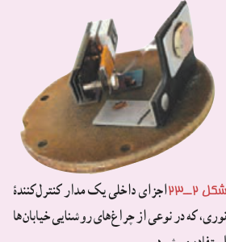
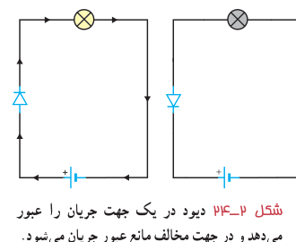
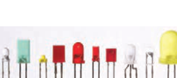
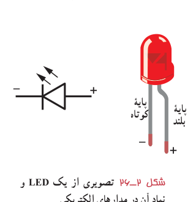

### فناوری و کاربرد

در یک نوع از چراغ‌های روشنایی، اساس کار به این ترتیب است که با تابش نور به LDR و ایجاد جریان در آن، یک گرم‌کن الکتریکی فعال شده و با استفاده از یک دماپا، اتصال لامپ‌های روشنایی به منبع اصلی جریان را قطع می‌کند. در شب که نوری به LDR برخورد نمی‌کند، گرم‌کن خاموش می‌ماند و بدین‌ترتیب، اتصال لامپ‌های روشنایی قطع نمی‌شود و لامپ‌ها روشن می‌مانند (شکل ۲ـ۲۳).

شکل ۲ـ۲۳ اجزای داخلی یک مدار کنترل‌کنندۀ نوری، که در نوعی از چراغ‌های روشنایی خیابان‌ها استفاده می‌شود.

۳ـ **دیودها**¹: دیود قطعه‌ای است که هرگاه در مداری قرار گیرد، جریان را تنها از یک سو عبور می‌دهد و مقاومت آن در برابر عبور جریان در این سو ناچیز است. به همین دلیل، دیود را اغلب به عنوان یک‌سوکنندۀ جریان در نظر می‌گیرند و آن را با نماد دیود در مدارهای الکتریکی نشان می‌دهند. پیکان در این نماد جهتی را نشان می‌دهد که جریان می‌تواند از دیود عبور کند. مثلاً مدارهای سادۀ شکل ۲ـ۲۴ نشان می‌دهد که با تعویض جهت دیود، جریان از مدار عبور نمی‌کند و لامپ خاموش می‌شود. همچنین از دیود در مدارهای یک‌سوکننده برای تبدیل جریان‌های متناوب به جریان‌های مستقیم استفاده می‌شود که در فصل ۴ با آن آشنا می‌شوید.

شکل ۲ـ۲۴ دیود در یک جهت جریان را عبور می‌دهد و در جهت مخالف مانع عبور جریان می‌شود.

دیودها انواع متفاوتی دارند که یکی از معروف‌ترین آنها دیودهای نورگسیل یا LED² است (شکل ۲ـ۲۵). شکل ۲ـ۲۶ تصویری واضح از یک LED و نماد آن در مدارهای الکتریکی را نشان می‌دهد. در این دیودها از نیم‌رساناهایی استفاده می‌شود که با عبور جریان از آنها LED از خود نور گسیل می‌کند و بنابراین، مقداری از انرژی الکتریکی به نور تبدیل می‌شود. بسته به نوع نیم‌رسانای به‌کاررفته، رنگ نور گسیل شده از LED می‌تواند از فروسرخ تا فرابنفش باشد. نخستین LEDهای ساخته‌شده، قرمز و زرد بودند. فناوری LED در دهۀ ۹۰ میلادی با تولید LEDهایی که قابلیت تولید نور آبی و سفید داشتند، دستخوش تحول بزرگی شد. LED در مقایسه با لامپ‌های روشنایی معمولی، توان الکتریکی کمی مصرف کرده و در عوض، نور قابل ملاحظه‌ای تولید می‌کند. به همین دلیل از آنها در چراغ خودروها، روشنایی منازل، تابلوهای تبلیغاتی، نمایشگرهای LED و ... استفاده می‌شود. LEDها در مقایسه با لامپ‌های رشته‌ای عمر طولانی‌تری دارند و به‌دلیل نداشتن رشته به هنگام تولید نور انرژی گرمایی زیادی تولید نمی‌کنند.

شکل ۲ـ۲۵ تصویری از چند دیود نورگسیل.

شکل ۲ـ۲۶ تصویری از یک LED و نماد آن در مدارهای الکتریکی.

۱ـ Diode  ۲ـ Light Emitting Diode
