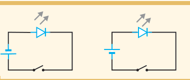
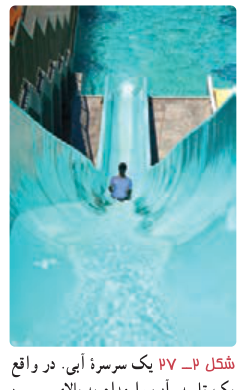
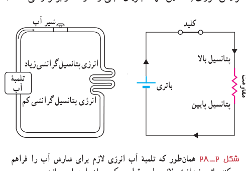
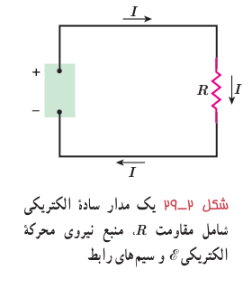

### پرسش ۲ـ۱

در کدام شکل با بستن کلید، LED روشن می‌شود؟

## ۲ـ۴ نیروی محرکۀ الکتریکی و مدارها

برای بالا بردن آب از سطح زمین به یک تلمبۀ آب نیاز است تا آب را به ارتفاع معینی برساند. بدین ترتیب، آب انرژی پتانسیل گرانشی لازم برای جریان یافتن و انجام کار معینی را کسب می‌کند (شکل ۲ـ۲۷). برای اینکه بارهای الکتریکی نیز در مدار جریان پیدا کنند و بتوانند از یک مقاومت الکتریکی عبور کنند، لازم است بین دو سر مقاومت اختلاف پتانسیلی برقرار کنیم تا انرژی لازم به بارهای الکتریکی داده شود. این کار می‌تواند توسط وسیله‌هایی مانند باتری انجام شود. به چنین وسیله‌هایی که با انجام کار روی بار الکتریکی، جریان ثابتی از بارهای الکتریکی در یک مدار ایجاد می‌کند، منبع نیروی محرکۀ الکتریکی گفته می‌شود. منبع‌های نیروی محرکۀ الکتریکی (مانند باتری‌ها) بارهای الکتریکی مثبت را درون خود در خلاف جهت میدان الکتریکی از پتانسیل پایین‌تر به پتانسیل بالاتر می‌برند و با افزایش انرژی پتانسیل آنها، جریان ثابتی را در مدار برقرار می‌کنند (شکل ۲ـ۲۸).

شکل ۲ـ۲۷ یک سرسرۀ آبی. در واقع یک تلمبه، آب را مدام به بالای سرسره پمپ می‌کند و موجب جریان یافتن آب و سر خوردن شخص بر روی سرسره می‌شود.

شکل ۲ـ۲۸ همان‌طور که تلمبۀ آب انرژی لازم برای شارش آب را فراهم می‌کند، باتری نیز انرژی لازم برای برقراری یک جریان را مهیا می‌سازد.

انرژی لازم برای ایجاد اختلاف پتانسیل الکتریکی در یک منبع نیروی محرکۀ الکتریکی با سازوکارهای مختلفی به دست می‌آید. مثلاً باتری‌ها که در علوم هشتم با آنها آشنا شدید این انرژی را از طریق واکنش‌های شیمیایی که در آنها رخ می‌دهد مهیا می‌سازند. پیل‌های سوختی، سلول‌های خورشیدی، و مولدهای الکتریکی نمونه‌های دیگری از منبع‌های نیروی محرکۀ الکتریکی‌اند.

مدار سادۀ الکتریکی شکل ۲ـ۲۹ را در نظر بگیرید. منبع نیروی محرکه هنگام عبور بار $\Delta q$ از منبع کاری به اندازۀ $\Delta W$ روی آن انجام می‌دهد تا آن را در مدار به حرکت درآورد. کاری که منبع نیروی محرکۀ الکتریکی روی واحد بار الکتریکی مثبت انجام می‌دهد تا آن را از پایانه با پتانسیل کمتر به پایانه با

شکل ۲ـ۲۹ یک مدار سادۀ الکتریکی شامل مقاومت $R$، منبع نیروی محرکۀ الکتریکی $\mathcal E$ و سیم‌های رابط.
