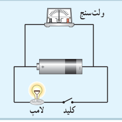
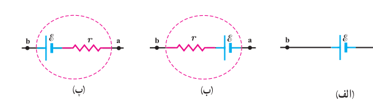

پتانسیل بیشتر ببرد، اصطلاحاً نیروی محرکۀ الکتریکی (emf¹) نامیده و با رابطۀ زیر تعریف می‌شود:²

$$\mathcal E=\frac{\Delta W}{\Delta q}\tag{2-5}$$

یکای کمیت نیروی محرکۀ الکتریکی همان یکای اختلاف پتانسیل الکتریکی، یعنی ولت (V) است ($1\,\mathrm V=1\,\mathrm{J/C}$). پس اگر نیروی محرکۀ یک باتری مثلاً ۱/۵ V باشد، به این معناست که باتری روی هر کولن باری که از آن می‌گذرد ۱/۵ J کار انجام می‌دهد و به این ترتیب انرژی پتانسیل الکتریکی آن را ۱/۵ J افزایش می‌دهد (باتری بدون اتلاف انرژی).

### فعالیت ۲ـ۴

به کمک یک باتری، سیم‌های رابط، لامپ کوچک، ولت‌سنج و کلید، مداری همانند شکل روبه‌رو درست کنید. قبل از بستن کلید عددی را که ولت‌سنج نشان می‌دهد بخوانید. سپس کلید را ببندید و دوباره عددی را که ولت‌سنج نشان می‌دهد بخوانید. در کدام حالت ولت‌سنج عدد بزرگ‌تری را نشان می‌دهد؟ چرا؟ در ادامه با علت تفاوت این دو عدد آشنا خواهید شد.

منبع‌های نیروی محرکۀ الکتریکی، یا آرمانی هستند و یا واقعی. اگر پایانه‌های منفی و مثبت یک منبع نیروی محرکه را به ترتیب با a و b نمایش دهیم، اختلاف پتانسیل میان این دو پایانه برای یک منبع آرمانی برابر با نیروی محرکۀ الکتریکی $\mathcal E$ آن است:

$$V_b-V_a=\mathcal E\tag{2-6}$$

### فعالیت ۲ـ۵

میدان الکتریکی درون باتری از پایانۀ مثبت به سمت پایانۀ منفی است. توضیح دهید چرا وقتی از پایانۀ مثبت باتری به سمت پایانۀ منفی آن می‌رویم، پتانسیل کاهش می‌یابد و بالعکس.

منبع آرمانی در واقعیت وجود ندارد و منبع‌های نیروی محرکۀ الکتریکی همواره دارای مقاومتی داخلی ($r$) هستند؛ یعنی درون آنها مقاومتی در برابر حرکت بارها وجود دارد. بنابراین، وقتی جریان از این منابع بگذرد، اختلاف پتانسیل بین پایانه‌های آنها برخلاف منابع آرمانی، متفاوت از نیروی محرکۀ الکتریکی خواهد شد. شکل ۲ـ۳۰ نماد منبع نیروی محرکه را در مدارهای الکتریکی نشان می‌دهد.

شکل ۲ـ۳۰ در مدارهای الکتریکی، منبع نیروی محرکۀ الکتریکی آرمانی را به‌صورت (الف) و منبع‌های واقعی را به‌صورت (ب) یا (پ) نمایش می‌دهند.

۱ـ Electromotive Force  
۲ـ توجه کنید که نیروی محرکۀ الکتریکی واژۀ نامناسبی است؛ زیرا emf نیرو نیست؛ بلکه مانند پتانسیل یک کمیت انرژی به ازای واحد بار است.
