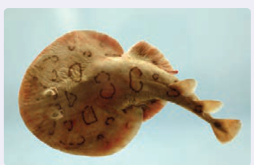

### خوب است بدانید: ماهی الکتریکی

ماهی‌های عظیم‌الجثۀ الکتریکی مانند تورپیدو در اقیانوس اطلس شمالی و ماهی الکتروفوروس در آمازون می‌توانند جریانی کافی برای کشتن یا بی‌حس کردن طعمه، یا حتی بی‌حس کردن یک انسان تولید کنند. مثلاً ماهی تورپیدو این کار را با یک تپ (پالس) ۵۰ آمپر و حدوداً ۶۰ ولت انجام می‌دهد. در زمان‌های دور، گاهی از ماهی‌های الکتریکی برای مقاصد درمانی استفاده می‌شد که این نخستین نوع شوک‌درمانی بود. ولتاژ این شوک ناشی از سلول‌های زیستی پولکی‌شکلی موسوم به الکتروپلاک است که در واقع مانند یک باتری عمل می‌کنند. شکل، تصویر ماهی الکتریکی تورپیدو را نشان می‌دهد. در زیر بالچه‌های این ماهی، انبوهی از الکتروپلاک‌ها کنار هم قرار گرفته‌اند.

### خوب است بدانید: آثار تخریبی الکتریسیته بر بدن انسان

اگر بین دو نقطه از بدن ما اختلاف پتانسیلی برقرار شود، جریان الکتریکی از بدن می‌گذرد. مقدار این جریان به مقاومت الکتریکی بدن بستگی دارد که عمدتاً ناشی از پوست است. هرچه پوست خشک‌تر باشد، مقاومت بیشتری دارد، ولی اگر پوست خیس یا مرطوب باشد، زخمی سر باز داشته باشد، و یا با کرمی پوشیده شده باشد، مقاومت کمتر می‌شود و مقدار خطرناکی از جریان می‌تواند از بدن شخص عبور کند. به همین ترتیب، اگر شخصی بر زمین خیس، یا در آب ایستاده باشد و بین نقطه‌ای از بدن او با منبع ولتاژ تماس خوبی برقرار شود، جریان نسبتاً زیادی از بدن وی عبور خواهد کرد. در این صورت، حتی اگر ولتاژ کم هم باشد، جریان می‌تواند آن‌قدر زیاد باشد که موجب مرگ شود. از سوی دیگر اگر مقاومت الکتریکی منطقۀ تماس زیاد باشد و مثلاً شخص بر پایه‌های عایق ایستاده باشد، این خطر بسیار کم می‌شود.

### اثر جریان‌های الکتریکی بر بدن

| جریان | اثر |
|---|---|
| کمتر از ۰/۰۰۰۱ A | جریان حس نمی‌شود. |
| ۰/۰۰۰۱ A | احساس سوزش یا گرما |
| ۰/۰۰۱ A تا ۰/۰۱ A | انقباض غیرعادی عضله‌ها، احساس درد |
| ۰/۰۱۵ A | از دست رفتن کنترل عضله‌ها |
| ۰/۰۷ A | اگر از قلب بگذرد، سبب اختلال جدی می‌شود. |
| ۰/۱۰ A تا ۰/۵۰ A | پرش عضلۀ بطنی قلب |
| ۰/۵۰ A تا چند آمپر | ایست قلبی، اگر جریان سریع قطع شود، قلب مجدداً به کار می‌افتد. |
| بیشتر از چند آمپر | ایست قلبی، قطع تنفس، سوختگی. |

دستگاه مرکزی اعصاب انسان در مقابل شوک‌های الکتریکی بسیار آسیب‌پذیر است. اگر جریانی که در یک شوک الکتریکی از مغز می‌گذرد بزرگ باشد، ممکن است به بیهوشی کامل بینجامد و حتی در برخی موارد موجب فراموشی شود، به‌طوری که بیمار زمان‌های قبل از وقوع حادثه را نیز به یاد نمی‌آورد. معمولاً مرگ در اثر شوک الکتریکی به سبب ایست قلبی یا تنفسی روی می‌دهد. جدول بالا اثر برخی از جریان‌های الکتریکی بر بدن را نشان می‌دهد.
