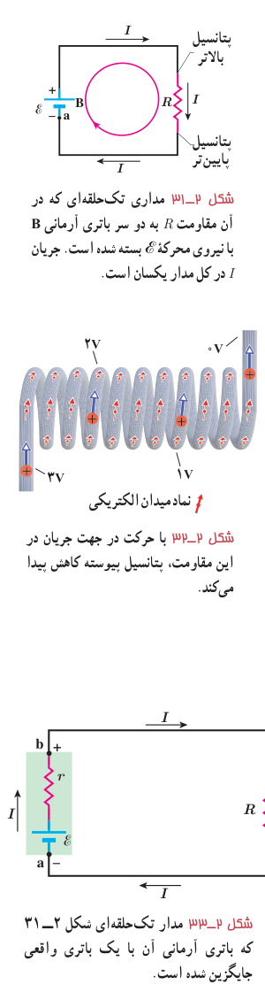

**مدار تک‌حلقه‌ای و افت پتانسیل در مقاومت:** مدار سادۀ تک‌حلقه‌ای شکل ۲ـ۳۱ را در نظر بگیرید. این مدار شامل باتری آرمانی B با نیروی محرکۀ $\mathcal E$، مقاومت $R$، و دو سیم رابط است. فرض کنید می‌خواهیم از نقطۀ دلخواهی شروع کنیم و مدار را به‌طور ذهنی در یک جهت دور بزنیم و هرجا با اختلاف پتانسیل‌ها مواجه شدیم، آنها را به‌طور جبری جمع کنیم. اگر از نقطۀ a مثلاً به‌طور ساعتگرد شروع کنیم، نخست با باتری B مواجه می‌شویم. همان‌طور که دیدیم با حرکت از پایانۀ منفی باتری به سمت پایانۀ مثبت آن پتانسیل الکتریکی به اندازۀ $+\mathcal E$ افزایش می‌یابد. وقتی در طول سیم بالایی حرکت می‌کنیم، هیچ تغییر پتانسیلی وجود ندارد؛ زیرا در بستن مدارها فرض کرده‌ایم از سیم‌های رابط با مقاومت ناچیز استفاده شده است. وقتی از مقاومت می‌گذریم پتانسیل طبق رابطۀ $\Delta V=IR$ تغییر می‌کند، ولی توجه کنید پتانسیل باید کاهش یابد؛ زیرا ما از طرف پتانسیل بالاتر به سمت پتانسیل پایین‌تر حرکت کرده‌ایم (شکل ۲ـ۳۲). بنابراین، در شکل ما تغییر پتانسیل هنگام عبور از مقاومت برابر با $-IR$ است؛ یعنی اصطلاحاً در مقاومت افت پتانسیلی رخ می‌دهد. اگر با حرکت در طول سیم پایینی به نقطۀ a باز گردیم چون مقاومت این سیم نیز ناچیز فرض شده است باز تغییر پتانسیل نخواهیم داشت. با بازگشت به نقطۀ a، پتانسیل دوباره برابر با پتانسیل نقطۀ a می‌شود؛ یعنی می‌توان نوشت:

$$V_a+\mathcal E-IR=V_a$$

و با حذف $V_a$ از دو طرف معادلۀ بالا به رابطۀ زیر می‌رسیم:

$$\mathcal E-IR=0$$

این رابطه نشان می‌دهد که جمع جبری اختلاف پتانسیل‌ها در مدار ما برابر با صفر است. توجه کنید که اگر حلقه را در خلاف جهت نشان داده شده در شکل دور می‌زدیم به رابطۀ $-\mathcal E+IR=0$ می‌رسیدیم که همان رابطۀ بالاست. در حالت کلی جمع جبری اختلاف پتانسیل‌ها در هر حلقه صفر است. به این قاعده، **قاعدۀ حلقه** می‌گویند. قاعدۀ حلقه یا قانون ولتاژها بیان می‌دارد:

**در هر دور زدن کامل حلقه‌ای از مدار، جمع جبری اختلاف پتانسیل‌های اجزای مدار صفر است.**

نشان داده می‌شود که قاعدۀ حلقه چیزی جز پایستگی انرژی نیست (تمرین ۲ـ۴ را ببینید). اکنون اگر باتری آرمانی مدار شکل ۲ـ۳۱ را با یک باتری واقعی که مقاومت داخلی $r$ دارد جایگزین کنیم (شکل ۲ـ۳۳)، با به‌کاربستن قاعدۀ حلقه به رابطۀ زیر می‌رسیم:

$$\mathcal E-Ir-IR=0$$

همچنین می‌توانیم اختلاف پتانسیل دو سر باتری را نیز به‌دست آوریم. اگر از نقطۀ a در جهت جریان $I$ به سمت نقطۀ b حرکت کنیم، می‌توانیم با در نظر گرفتن اختلاف پتانسیل‌ها رابطۀ زیر را بنویسیم:

$$V_a+\mathcal E-Ir=V_b$$

و یا

$$V_b-V_a=\mathcal E-Ir\tag{2-7}$$

در حل مسئله‌های مدار تک‌حلقه‌ای همواره دو دستورالعمل سادۀ زیر را به کار می‌بندیم:

۱ـ هرگاه در مدار در جهت جریان از مقاومتی مثلاً $R$ بگذریم، پتانسیل به اندازۀ $IR$ کاهش می‌یابد و اگر در خلاف جهت جریان حرکت کنیم پتانسیل به همان اندازه افزایش می‌یابد.

شکل ۲ـ۳۱ مداری تک‌حلقه‌ای که در آن مقاومت $R$ به دو سر باتری آرمانی B با نیروی محرکۀ $\mathcal E$ بسته شده است. جریان $I$ در کل مدار یکسان است. شکل ۲ـ۳۲ با حرکت در جهت جریان در این مقاومت، پتانسیل پیوسته کاهش پیدا می‌کند. شکل ۲ـ۳۳ مدار تک‌حلقه‌ای شکل ۲ـ۳۱ که باتری آرمانی آن با یک باتری واقعی جایگزین شده است.
