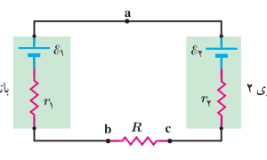
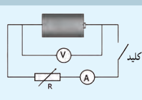

### مثال ۲ـ۷

مدار شکل روبه‌رو را در نظر بگیرید. مقادیر نیروهای محرکۀ الکتریکی و مقاومت‌های مدار عبارت‌اند از:

$$\mathcal E_1=8/0\,\mathrm V,\quad\mathcal E_2=2/0\,\mathrm V,\quad r_1=2/0\,\Omega,\quad r_2=1/5\,\Omega,\quad R=8/5\,\Omega$$

الف) جهت جریان عبوری از مدار و مقدار آن را تعیین کنید. ب) اختلاف پتانسیل دوسر باتری‌های ۱ و ۲ را محاسبه کنید.

**پاسخ:** الف) با استفاده از دستورالعمل‌های حل مدارهای تک‌حلقه‌ای، مسئله را حل می‌کنیم. گرچه لازم نیست که جهت جریان $I$ را بدانیم، ولی می‌توانیم آن را با مقایسۀ نیروهای محرکۀ الکتریکی دو باتری تعیین کنیم؛ چون $\mathcal E_1>\mathcal E_2$ است جهت جریان را باتری ۱ تعیین می‌کند. بنابراین، جهت جریان، ساعتگرد است. در نتیجه با حرکت پادساعتگرد از نقطۀ a داریم:

$$V_a-\mathcal E_1+Ir_1+IR+Ir_2+\mathcal E_2=V_a$$

و از آنجا

$$I=\frac{\mathcal E_1-\mathcal E_2}{r_1+R+r_2}=\frac{8/0\,\mathrm V-2/0\,\mathrm V}{2/0\,\Omega+8/5\,\Omega+1/5\,\Omega}=0/50\,\mathrm A$$

ب) اختلاف پتانسیل بین دوسر باتری ۱ را با حرکت از نقطۀ b به سمت نقطۀ a به‌دست می‌آوریم:

$$V_b-Ir_1+\mathcal E_1=V_a$$

در نتیجه

$$V_a-V_b=\mathcal E_1-Ir_1=8/0\,\mathrm V-(0/50\,\mathrm A)(2/0\,\Omega)=7/0\,\mathrm V$$

که این نتیجه را می‌توانستیم به‌طور مستقیم از رابطۀ ۲ـ۷ نیز به‌دست آوریم. اما در مورد باتری ۲ که در آن جهت جریان از قطب مثبت وارد و از قطب منفی خارج می‌شود، نمی‌توانیم از این رابطه استفاده کنیم. برای محاسبۀ اختلاف پتانسیل دوسر باتری ۲ حتماً باید مسئله را از نو حل کرد. به این منظور، از نقطۀ c به سمت نقطۀ a حرکت می‌کنیم:

$$V_c+Ir_2+\mathcal E_2=V_a$$

و در نتیجه:

$$V_a-V_c=\mathcal E_2+Ir_2=2/0\,\mathrm V+(0/50\,\mathrm A)(1/5\,\Omega)=2/8\,\mathrm V$$

### فعالیت ۲ـ۶ (کار در کلاس)

تفاوت یک باتری نو و فرسوده عمدتاً در مقدار مقاومت داخلی آن است که می‌تواند کمتر از یک اهم برای باتری نو تا چند هزار اهم برای باتری فرسوده باشد. برای اندازه‌گیری مقاومت داخلی یک باتری مدار ساده‌ای متشکل از یک باتری، یک کلید قطع و وصل، و یک مقاومت یا لامپ کوچک را سوار کنید. نخست درحالی که کلید قطع است، ولتاژ دو سر باتری را با یک ولت‌سنج اندازه بگیرید و آن‌گاه پس از بستن کلید، دوباره ولتاژ دو سر باتری را اندازه بگیرید. همچنین در این حالت، جریان عبوری از مدار را نیز باید به کمک یک آمپرسنج اندازه بگیرید. اکنون با استفاده از رابطۀ ۲ـ۷ مقاومت داخلی باتری را محاسبه کنید (البته در یک اندازه‌گیری دقیق‌تر معمولاً از یک مقاومت متغیر استفاده می‌شود و مقاومت داخلی پس از چندین اندازه‌گیری محاسبه می‌شود). آزمایش را یک بار برای باتری نو و یک بار برای باتری فرسوده انجام دهید.

