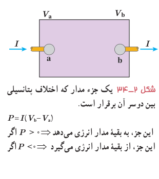

## ۲ـ۵ توان در مدارهای الکتریکی

اکنون می‌خواهیم رابطه‌هایی برای انرژی و توان در مدارهای الکتریکی به‌دست آوریم. جعبۀ شکل ۲ـ۳۴ بخشی از یک مدار الکتریکی را نشان می‌دهد که می‌تواند شامل باتری، مقاومت و یا هرچیز دیگری باشد که اختلاف پتانسیلی بین پایانه‌های آن برقرار است. فرض کنید بار $q$ در مدت زمان $t$ تحت اختلاف پتانسیل $\Delta V=V_b-V_a$ از پایانۀ a به پایانۀ b برود. در فصل پیش دیدیم کار نیروی خارجی برای چنین انتقالی برابر با $W=q\Delta V$ است. از طرفی توان الکتریکی، آهنگ انجام این کار است:

$$P=\frac Wt=\frac{q\Delta V}{t}=\left(\frac qt\right)\Delta V=I\Delta V$$
$$P=I\Delta V\tag{2-8}$$

در این رابطه، توان ($P$) برحسب وات (W)، جریان ($I$) برحسب آمپر (A) و اختلاف پتانسیل ($\Delta V$) برحسب ولت (V) است. این رابطه را می‌توان برای منبع نیروی محرکه (مثلاً باتری)، یا برای وسیلۀ مصرف‌کننده (مثلاً مقاومت یک دستگاه الکتریکی) و یا ... استفاده کرد.

شکل ۲ـ۳۴ یک جزء مدار که اختلاف پتانسیلی بین دوسر آن برقرار است. $P=I(V_b-V_a)$. اگر $P>0$ این جزء به بقیۀ مدار انرژی می‌دهد و اگر $P<0$ این جزء از بقیۀ مدار انرژی می‌گیرد.

**توان الکتریکی مصرفی در یک مقاومت:** همان‌طور که گفتیم رابطۀ ۲ـ۸ برای مقاومت‌های الکتریکی نیز برقرار است. برای یک مقاومت، همان‌طور که پیش از این دیدیم $\Delta V$ را با $V$ نشان می‌دهیم. برای محاسبۀ مقدار توان مصرفی، کافی است در این رابطه به‌جای $V$ از رابطۀ تعریف مقاومت ($R=V/I$) استفاده کنیم:

$$P_{\text{مصرفی}}=|P|=|IV|=|I(RI)|=RI^2=\frac{V^2}{R}$$

در نتیجه:

$$P_{\text{مصرفی}}=RI^2\tag{2-9}$$
$$P_{\text{مصرفی}}=\frac{V^2}{R}\tag{2-10}$$

### مثال ۲ـ۸

وقتی دو سر یک بخاری برقی را به اختلاف پتانسیل ۲۲۰ V وصل کنیم، جریان ۱۰/۰ A از آن می‌گذرد. الف) توان این بخاری چقدر است؟ ب) اگر این بخاری به مدت ۳/۰۰ h در روز کار کند و قیمت برق مصرفی به ازای هر کیلووات ساعت ۵۰ تومان باشد، هزینۀ یک ماه مصرف این بخاری چقدر می‌شود؟

**پاسخ:** الف) بنا به رابطۀ ۲ـ۸ توان مورد نیاز بخاری چنین می‌شود:

$$P=I\Delta V=(10/0\,\mathrm A)(220\,\mathrm V)=2/20\times10^3\,\mathrm W=2/20\,\mathrm{kW}$$

ب) انرژی مصرفی بخاری برابر $Pt$ می‌شود که بر حسب یکاهای SI، $P$ بر حسب وات (W) و $t$ بر حسب ثانیه (s) است و انرژی مصرفی بر حسب ژول (J) می‌شود. اما برای محاسبۀ مصرف برق، $P$ را بر حسب کیلووات (kW) و $t$ را بر حسب ساعت (h) می‌گیرند. بنابراین، انرژی الکتریکی مصرفی بر حسب کیلووات ساعت (kWh) می‌شود ($1\,\mathrm{kWh}=(1000\,\mathrm{J/s})(3600\,\mathrm s)=3/6\times10^6\,\mathrm J$).
