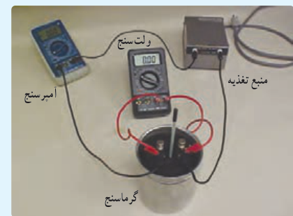
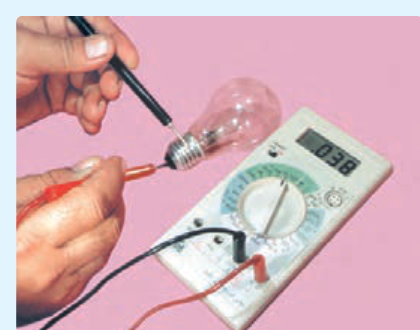
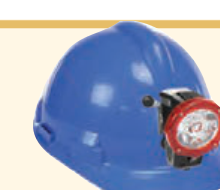

پس انرژی مصرفی بخاری در یک ماه، برابر است با

$$U=Pt=(2/20\,\mathrm{kW})(30\times3/00\,\mathrm h)=198\,\mathrm{kWh}$$

در نتیجه بهای برق مصرفی این بخاری در یک ماه چنین می‌شود:

$$\text{بها}=(198\,\mathrm{kWh})(50\,\text{تومان/kWh})=9900\,\text{تومان}$$

### فعالیت ۲ـ۷

قانون ژول بیان می‌دارد گرمای تولید شده توسط جریان $I$ عبوری از یک مقاومت $R$ در مدت زمان $t$ برابر با $RI^2t$ است. این قانون را می‌توان به روش گرماسنجی با یک گرماسنج که در فیزیک دهم با آن آشنا شدید تحقیق کرد. اسباب این آزمایش در شکل نشان داده شده است. دربارۀ چگونگی این آزمایش توضیح دهید.

### فعالیت ۲ـ۸

الف) همانند شکل با یک اهم‌متر، مقاومت رشتۀ سیم داخل لامپ ۱۰۰ واتی را اندازه‌گیری کنید. سپس با استفاده از رابطۀ ۲ـ۱۰ و با داشتن مشخصات روی لامپ، مقاومت آن را در حالت روشن محاسبه کنید. نتیجۀ محاسبه را با مقدار اندازه‌گیری‌شده مقایسه کنید و نتیجه را پس از گفت‌وگوی گروهی گزارش دهید.

ب) اکنون با استفاده از نتیجۀ به‌دست آمده، دمای رشتۀ سیم داخل لامپ را در حال روشن برآورد کنید (رشتۀ سیم لامپ از جنس تنگستن و ضریب دمایی مقاومت ویژۀ آن $4/5\times10^{-3}\,^\circ\mathrm C^{-1}$ است¹).

### پرسش ۲ـ۲

اگر لامپ‌های رشته‌ای (التهابی) را با لامپ‌های LED جایگزین کنیم، درخواهیم یافت که در مصرف انرژی تفاوت چشمگیری حاصل می‌شود. مثلاً درحالی که لامپ هالوژن یک کلاه ایمنی چند باتری را در ۳ ساعت مصرف می‌کند، نوع LED همان لامپ، آن باتری‌ها را در ۳۰ ساعت به مصرف می‌رساند. دلیل این اختلاف را بیان کنید.

۱ـ مقاومت ویژۀ تنگستن در یک گستره بزرگ دمایی تا نزدیکی نقطۀ ذوبش در ۳۴۰۰°C رفتاری خطی دارد.
