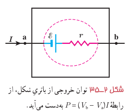
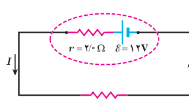
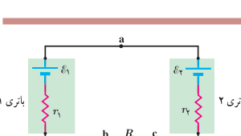

**توان خروجی یک منبع نیروی محرکۀ واقعی:** در بخش پیش اختلاف پتانسیل $\Delta V$ دو سر یک باتری واقعی را مانند شکل ۲ـ۳۵ به‌صورت $\mathcal E-Ir$ به‌دست آوردیم. با قرار دادن این اختلاف پتانسیل در رابطۀ توان الکتریکی خواهیم داشت:

$$P_{\text{خروجی}}=I\Delta V=I(\mathcal E-Ir)=\mathcal E I-rI^2$$
$$P_{\text{خروجی}}=\mathcal E I-rI^2\tag{2-11}$$

که این توان خروجی یک باتری واقعی است. همان‌طور که می‌بینیم این توان به اندازۀ $rI^2$ (توان مربوط به انرژی اتلافی در مقاومت داخلی باتری که سبب گرم شدن آن می‌شود) با توان تولیدی باتری ($\mathcal E I$) متفاوت است. اگر باتری آرمانی باشد ($r=0$) توان خروجی با توان تولیدی آن برابر است.

شکل ۲ـ۳۵ توان خروجی از باتری شکل، از رابطۀ $P=(V_b-V_a)I$ به‌دست می‌آید.

### مثال ۲ـ۹

برای مدار نشان داده شده در شکل: الف) توان خروجی باتری و ب) توان مصرفی در مقاومت را محاسبه کنید.

**پاسخ:** الف) نخست، جریان را با استفاده از قاعدۀ حلقه به‌دست می‌آوریم:

$$V_a+\mathcal E-Ir-IR=V_a\Rightarrow I=\frac{\mathcal E}{R+r}=\frac{12\,\mathrm V}{4/0\,\Omega+2/0\,\Omega}=2/0\,\mathrm A$$

اکنون توان الکتریکی خروجی از باتری با استفاده از رابطۀ ۲ـ۱۱ چنین می‌شود:

$$P_{\text{خروجی}}=\mathcal E I-rI^2=(12\,\mathrm V)(2/0\,\mathrm A)-(2/0\,\Omega)(2/0\,\mathrm A)^2=16\,\mathrm W$$

ب) با استفاده از پایستگی انرژی بدیهی است که توان الکتریکی مصرفی در مقاومت ۴ اهمی برابر با توان خروجی باتری، یعنی ۱۶ W می‌شود. با این حال، این را می‌توانیم به‌طور مستقیم نیز نشان دهیم:

$$P_{\text{مصرفی}}=RI^2=(4/0\,\Omega)(2/0\,\mathrm A)^2=16\,\mathrm W$$

### مثال ۲ـ۱۰

در مثال ۲ـ۷ توان هر یک از اجزای مدار را محاسبه کنید.

**پاسخ:** توان مصرفی در مقاومت $R=8/5\,\Omega$ با استفاده از رابطۀ ۲ـ۹ چنین می‌شود:

$$P_{\text{مصرفی}}=RI^2=(8/5\,\Omega)(0/50\,\mathrm A)^2=2/1\,\mathrm W$$

که در آن از $I=0/50\,\mathrm A$ استفاده کرده‌ایم. توان خروجی باتری ۱ را با استفاده از رابطۀ ۲ـ۱۱ محاسبه می‌کنیم:

$$P_{\text{خروجی}}=\mathcal E_1I-r_1I^2=(8/0\,\mathrm V)(0/50\,\mathrm A)-(2/0\,\Omega)(0/50\,\mathrm A)^2=3/5\,\mathrm W$$

اما توان باتری ۲ از رابطۀ ۲ـ۱۱ به‌دست نمی‌آید؛ زیرا همان‌طور که دیدیم اختلاف پتانسیل دوسر باتری ۲ از رابطۀ $V_a-V_c=\mathcal E_2+Ir_2$ به‌دست می‌آید. اما طبق تعریف این کتاب، برای استفاده از رابطۀ ۲ـ۸ ($P=I\Delta V$)، باید اختلاف پتانسیل $V_c-V_a$ را در نظر بگیریم که $-(\mathcal E_2+Ir_2)$ می‌شود. بنابراین، مقدار (قدرمطلق) توان ورودی به باتری ۲ چنین می‌شود:

$$P_{\text{ورودی}}=|P|=|I\Delta V|=I(\mathcal E_2+Ir_2)=\mathcal E_2I+r_2I^2$$
$$=(2/0\,\mathrm V)(0/50\,\mathrm A)+(1/5\,\Omega)(0/50\,\mathrm A)^2=1/4\,\mathrm W$$
