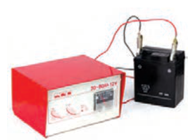
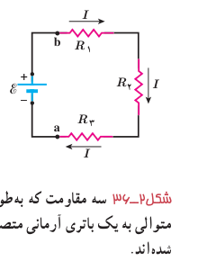

اینکه باتری ۲ انرژی مصرفی خود را از باتری ۱ تأمین می‌کند، همان اتفاقی است که هنگام اتصال یک باتری به شارژکننده روی می‌دهد. شارژکننده به باتری انرژی الکتریکی می‌دهد. بخشی از این انرژی به انرژی شیمیایی تبدیل می‌شود و بقیۀ آن در مقاومت درون باتری تلف می‌شود و باتری را گرم می‌کند. همان‌طور که انتظار داریم این نتیجه همچنین با پایستگی انرژی سازگار است:

$$\text{توان خروجی باتری ۱}=\text{توان ورودی باتری ۲}+\text{توان مصرفی مقاومت }R$$
$$3/5\,\mathrm W=1/4\,\mathrm W+2/1\,\mathrm W$$

### تمرین ۲ـ۴

با توجه به قانون ژول (فعالیت ۲ـ۷) و تعریف نیروی محرکۀ الکتریکی، برای یک حلقۀ ساده، شامل یک باتری و یک مقاومت نشان دهید که قاعدۀ حلقه یا قانون ولتاژها چیزی جز پایستگی انرژی نیست.

## ۲ـ۶ ترکیب مقاومت‌ها

مقاومت‌ها در انواع وسایل الکتریکی دیده می‌شوند، از ساده‌ترین وسیله‌ها مانند بخاری‌های برقی و موخشک‌کن‌ها گرفته تا وسایل الکتریکی پیچیده‌تری مانند تلویزیون و رایانه‌ها. مدارهای این وسیله‌ها اغلب چندین مقاومت دارند؛ در نتیجه لازم است که ترکیبی از مقاومت‌ها را در نظر بگیریم. رشته‌ای از لامپ‌ها که در چراغانی‌ها به کار می‌رود، نمونه ساده‌ای از ترکیب مقاومت‌هاست که در آن هر لامپ به‌عنوان یک مقاومت عمل می‌کند و رشتۀ لامپ‌ها از دیدگاه تحلیل مدار، ترکیبی است از مقاومت‌ها. ترکیب مقاومت‌ها ممکن است بسیار پیچیده باشد، اما کار کردن با دو نوع از این ترکیب‌ها بسیار ساده است: مقاومت‌های متوالی و مقاومت‌های موازی. وقتی مقاومت‌ها به‌طور متوالی، یا موازی یا ترکیبی از هر دو بسته شده باشند، آنها را می‌توانیم با یک مقاومت معادل جایگزین کنیم. در این بخش به این موضوع می‌پردازیم و اینکه چگونه می‌توان مقاومت معادل ترکیبی از مقاومت‌ها را تعیین کرد.

**به هم بستن متوالی مقاومت‌ها:** شکل ۲ـ۳۶ سه مقاومت را نشان می‌دهد که به‌طور متوالی به یک باتری آرمانی با نیروی محرکۀ الکتریکی $\mathcal E$ بسته شده‌اند. توجه کنید واژۀ «متوالی» ربط چندانی به چگونگی رسم مقاومت‌ها ندارد. «متوالی» به معنای بسته شدن مقاومت‌ها یکی پس از دیگری است، به‌طوری که هیچ انشعابی بین آنها وجود نداشته باشد و اختلاف پتانسیل $V$ به دوسر این مجموعه از مقاومت‌ها اعمال شده باشد. در بستن متوالی مقاومت‌ها از همۀ مقاومت‌ها جریان یکسان $I$ عبور می‌کند. به عبارتی اگر آمپرسنج‌هایی را در نقطه‌های مختلفی از این مدار قرار دهیم، همگی جریان یکسانی را نشان می‌دهند. مقاومت‌هایی را که به‌طور متوالی بسته شده‌اند می‌توان با یک مقاومت معادل $R_{eq}$ جایگزین کرد که دارای همان اختلاف پتانسیل کل اعمال شده به دو سر مجموعۀ مقاومت‌ها و همان جریان $I$ است.

با به‌کارگیری قاعدۀ حلقه، مثلاً با حرکت در جهت جریان $I$ و با شروع از نقطۀ a و بازگشت دوباره به آن، داریم:

$$V_a+\mathcal E-IR_1-IR_2-IR_3=V_a$$

و در نتیجه

$$\mathcal E=IR_1+IR_2+IR_3$$

شکل ۲ـ۳۶ سه مقاومت که به‌طور متوالی به یک باتری آرمانی متصل شده‌اند.
