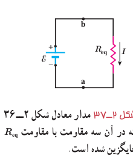
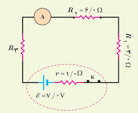
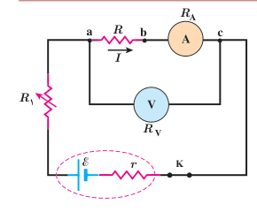

به عبارتی اختلاف پتانسیل کل اعمال شده، برابر با جمع اختلاف پتانسیل‌های دو سر مقاومت‌هاست: $V=\mathcal E=V_1+V_2+V_3$. اکنون به سراغ محاسبۀ جریان $I$ می‌رویم. از رابطۀ بالا داریم:

$$I=\frac{\mathcal E}{R_1+R_2+R_3}$$

با تعریف مقاومت معادل، به‌صورت $R_{eq}=R_1+R_2+R_3$ مدار شکل ۲ـ۳۶ را می‌توان با مدار معادل شکل ۲ـ۳۷ جایگزین کرد. بدیهی است که اگر به‌جای سه مقاومت، $n$ مقاومت متوالی داشته باشیم، مقاومت معادل آنها از رابطۀ زیر به‌دست می‌آید:

$$R_{eq}=R_1+R_2+R_3+\cdots+R_n\tag{2-12}$$

توجه کنید وقتی مقاومت‌ها به‌طور متوالی بسته شده‌اند، مقاومت معادل آنها بزرگ‌تر از مقاومت هریک از آنهاست.

شکل ۲ـ۳۷ مدار معادل شکل ۲ـ۳۶ که در آن سه مقاومت با مقاومت $R_{eq}$ جایگزین شده است.

### تمرین ۲ـ۵

در شکل روبه‌رو، سه مقاومت به همراه یک آمپرسنج به‌صورت متوالی به یک باتری وصل شده‌اند و مقاومت آمپرسنج صفر است (آمپرسنج آرمانی). اگر مقاومت معادل مقاومت‌های $R_1$، $R_2$ و $R_3$ برابر با $13/0\,\Omega$ باشد: الف) مقاومت $R_3$ چقدر است؟ ب) جریانی را که آمپرسنج نشان می‌دهد به‌دست آورید. پ) نشان دهید توان خروجی باتری با مجموع توان‌های مصرفی مقاومت‌های $R_1$، $R_2$ و $R_3$ در مدار برابر است.

### مثال ۲ـ۱۱

شکل روبه‌رو مداری را برای اندازه‌گیری مقاومت مجهول $R$ نشان می‌دهد. فرض کنید در این مدار ولت‌سنج $24/0\,\mathrm V$ و آمپرسنج $0/200\,\mathrm A$ را نشان دهند. مقاومت ولت‌سنج $R_V=1/00\times10^5\,\Omega$ و مقاومت آمپرسنج $R_A=1/00\,\Omega$ است. مقاومت $R$ را به‌دست آورید.

**پاسخ:** مقاومت‌های $R$ و $R_A$ به‌طور متوالی به هم بسته شده‌اند و اختلاف پتانسیل دوسر آنها برابر با ۲۴/۰ V است. با توجه به اینکه آمپرسنج جریان ۰/۲۰۰ A را نشان می‌دهد و به‌طور متوالی به مقاومت $R$ بسته شده است، جریان عبوری از این دو مقاومت نیز برابر با ۰/۲۰۰ A است:

$$R_{eq}=\frac VI=\frac{24/0\,\mathrm V}{0/200\,\mathrm A}=120\,\Omega$$

با توجه به اینکه $R_{eq}=R+R_A$ و $R_A=1/00\,\Omega$ است مقاومت مجهول برابر با $R=119\,\Omega$ می‌شود.

مقاومت یک ولت‌سنج باید خیلی بزرگ باشد تا قرار گرفتن آن در مدار، ولتاژ اجزای مدار را به‌طور محسوسی تغییر ندهد. همچنین مقاومت یک آمپرسنج باید خیلی ناچیز باشد تا قرار گرفتن آن در مدار به‌طور محسوسی جریان اجزای مدار را تغییر ندهد. همان‌طور که در مثال بالا ملاحظه شد، مقاومت‌های آمپرسنج و ولت‌سنج این ویژگی‌ها را دارند.
