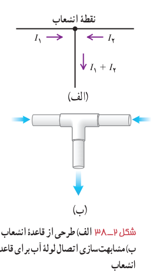
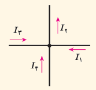
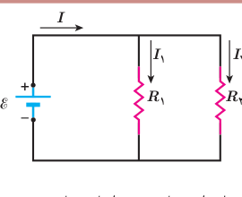

**قاعدۀ انشعاب و به‌هم بستن موازی مقاومت‌ها:** یک نقطۀ انشعاب (گره) در مدار، نقطه‌ای است که در آن سه یا چند سیم به یکدیگر متصل شده‌اند. هر اتصالی بین دو نقطۀ انشعاب در مدار، شاخه نامیده می‌شود. یک شاخه می‌تواند شامل هر تعدادی از اجزای مختلف مدار و سیم‌های بین آنها باشد. از هر شاخه یک جریان می‌گذرد. در هر نقطۀ انشعاب از مدار قاعده‌ای برای جریان‌ها برقرار است که به صورت زیر بیان شده است و به آن قاعدۀ انشعاب گفته می‌شود:

**مجموع جریان‌هایی که به هر نقطۀ انشعاب وارد می‌شود برابر با مجموع جریان‌هایی است که از آن نقطۀ انشعاب خارج می‌شود.**

قاعدۀ انشعاب در واقع مبتنی بر پایستگی بار الکتریکی است و اینکه هیچ باری نمی‌تواند در یک نقطۀ انشعاب جمع گردد. بنابراین، مجموع بار وارد شده به هر نقطۀ انشعاب در واحد زمان باید برابر با مجموع بار خارج شده از آن نقطه در واحد زمان باشد (شکل ۲ـ۳۸ـ الف). همان‌طور که می‌دانیم بار عبوری در واحد زمان همان جریان است. بنابراین، پایستگی بار، به قاعدۀ انشعاب جریان می‌انجامد. این مشابه یک اتصال سه‌راهی لوله‌های آب است (شکل ۲ـ۳۸ـ ب)؛ اگر یک لیتر آب در هر دقیقه از سمت چپ، و یک لیتر آب در هر دقیقه از سمت راست وارد اتصال شود، واضح است که آب خارج شده در هر دقیقه برابر با ۲ لیتر است.

شکل ۲ـ۳۸ الف) طرحی از قاعدۀ انشعاب. ب) مشابهت‌سازی اتصال لوله آب برای قاعدۀ انشعاب.

### پرسش ۲ـ۳

برای نقطۀ انشعاب نشان داده شده در شکل، رابطۀ بین جریان‌ها را بنویسید.

### مثال ۲ـ۱۲*

در شکل روبه‌رو، یک باتری آرمانی اختلاف پتانسیل $\mathcal E=12\,\mathrm V$ را به دوسر مقاومت‌های $R_1=4/0\,\Omega$ و $R_2=6/0\,\Omega$ اعمال می‌کند. الف) جریان عبوری از هر مقاومت و ب) جریانی که از باتری می‌گذرد چقدر است؟

**پاسخ:** مطابق شکل جریان عبوری از باتری، مقاومت $R_1$، و مقاومت $R_2$ را به ترتیب با $I$، $I_1$ و $I_2$ نشان داده‌ایم.

الف) بدیهی است که اختلاف پتانسیل دو سر مقاومت‌های $R_1$ و $R_2$ برابر با اختلاف پتانسیل باتری است. بنابراین داریم:

$$V_1=\mathcal E=I_1R_1\Rightarrow I_1=\frac{\mathcal E}{R_1}=\frac{12\,\mathrm V}{4/0\,\Omega}=3/0\,\mathrm A$$
$$V_2=\mathcal E=I_2R_2\Rightarrow I_2=\frac{\mathcal E}{R_2}=\frac{12\,\mathrm V}{6/0\,\Omega}=2/0\,\mathrm A$$

ب) اکنون با استفاده از قاعدۀ انشعاب، جریان عبوری از باتری را می‌یابیم:

$$I=I_1+I_2=3/0\,\mathrm A+2/0\,\mathrm A=5/0\,\mathrm A$$

* حل مدارهای چندحلقه‌ای که در حلقه‌های مختلف از باتری استفاده می‌شود و همچنین سایر به هم بستن‌های مقاومت‌ها به‌غیر از به هم بستن متوالی و موازی جزو برنامۀ درسی این کتاب نبوده و نباید در آموزش و ارزشیابی‌ها مدنظر قرار گیرد.
