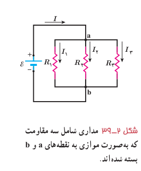
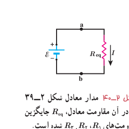

### فعالیت ۲ـ۹

مداری مانند مدار مثال ۲ـ۱۲ ببندید و در هر شاخۀ آن، یک آمپرسنج قرار دهید. با خواندن آمپرسنج‌ها، رابطۀ بین جریان‌ها را بررسی کنید.

**بستن مقاومت‌ها به‌صورت موازی:** شکل ۲ـ۳۹ یک مدار الکتریکی را نشان می‌دهد که سه مقاومت به‌صورت موازی به یک باتری آرمانی با نیروی محرکۀ الکتریکی $\mathcal E$ بسته شده‌اند. توجه کنید واژۀ «موازی» ارتباط چندانی به چگونگی رسم مقاومت‌ها ندارد؛ بلکه «به‌صورت موازی» به معنای آن است که یک سر مقاومت‌ها مستقیماً به یکدیگر و سر دیگر آنها نیز مستقیماً به هم وصل شده باشند و اختلاف پتانسیل یکسان $V$ به دوسر این مقاومت‌ها اعمال شده است. بنابراین، هر یک از مقاومت‌ها اختلاف پتانسیل یکسان $V$ در دوسر خود دارد؛ یعنی:

$$V=\mathcal E=V_1=V_2=V_3$$

شکل ۲ـ۳۹ مداری شامل سه مقاومت که به‌صورت موازی به نقطه‌های a و b بسته شده‌اند.

مجموعۀ مقاومت‌هایی که به این روش متصل شده‌اند را می‌توان با یک مقاومت معادل $R_{eq}$ جایگزین کرد که دارای همان اختلاف پتانسیل $V$ و جریان کلی است که از مقاومت‌ها می‌گذرد. برای یافتن عبارتی برای $R_{eq}$ نخست از قاعدۀ انشعاب استفاده می‌کنیم. اگر این قاعده را برای نقطۀ a شکل ۲ـ۳۹ به کار بریم خواهیم داشت:

$$I=I_1+I_2+I_3$$

از طرفی، از تعریف مقاومت می‌توانیم جریان‌های عبوری از هریک از مقاومت‌ها را به‌دست آوریم:

$$I_1=\frac V{R_1},\quad I_2=\frac V{R_2},\quad I_3=\frac V{R_3}$$

با قرار دادن این جریان‌ها در معادلۀ حاصل از قاعدۀ انشعاب خواهیم داشت:

$$I=V\left(\frac1{R_1}+\frac1{R_2}+\frac1{R_3}\right)$$

اگر ترکیب موازی مقاومت‌ها را با مقاومت $R_{eq}$ جایگزین کنیم $I=V/R_{eq}$ می‌شود و از آنجا خواهیم داشت:

$$\frac1{R_{eq}}=\frac1{R_1}+\frac1{R_2}+\frac1{R_3}$$

در حالت کلی برای $n$ مقاومت موازی به رابطۀ زیر می‌رسیم:

$$\frac1{R_{eq}}=\frac1{R_1}+\frac1{R_2}+\frac1{R_3}+\cdots+\frac1{R_n}\tag{2-13}$$

مدار شکل ۲ـ۳۹ به مدار معادل شکل ۲ـ۴۰ تبدیل می‌شود. توجه کنید هرگاه چند مقاومت به‌صورت موازی به هم بسته شوند، مقاومت معادل آنها کوچک‌تر از هریک از مقاومت‌های موجود در ترکیب است. برای اینکه به درکی از این نتیجه برسیم، دوباره مشابهت‌سازی با لوله‌های آب می‌تواند راه‌گشا باشد. شکل ۲ـ۴۱ـ الف دو لولۀ هم‌طول با سطح مقطع‌های $A_1$ و $A_2$ را نشان می‌دهد

شکل ۲ـ۴۰ مدار معادل شکل ۲ـ۳۹ که در آن مقاومت معادل $R_{eq}$ جایگزین مقاومت‌های $R_1$، $R_2$ و $R_3$ شده است.
