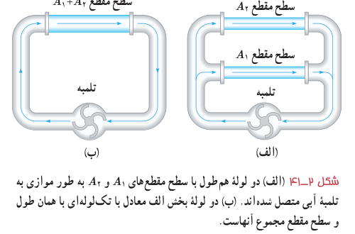
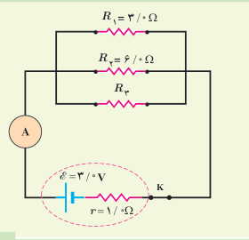
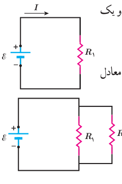

که به‌طور موازی به یک تلمبۀ آب متصل شده‌اند. در شکل ۲ـ۴۱ـ ب این دو لوله با یک تک‌لوله به همان طول آنها، ولی با سطح مقطعی برابر با مجموع سطح مقطع‌های آن دو لوله جایگزین شده است. اکنون تلمبه، آب بیشتری از لولۀ عریض‌تر در مقایسه با هریک از لوله‌ها عبور می‌دهد. به عبارتی، لولۀ عریض‌تر مقاومت کمتری نسبت به شارش آب در مقایسه با هریک از دو لولۀ باریک‌تر دارد.

شکل ۲ـ۴۱ الف) دو لولۀ هم‌طول با سطح مقطع‌های $A_1$ و $A_2$ به‌طور موازی به تلمبۀ آبی متصل شده‌اند. ب) دو لولۀ بخش الف معادل با تک‌لوله‌ای با همان طول و سطح مقطع مجموع آنهاست.

### تمرین ۲ـ۶

در شکل روبه‌رو سه مقاومت موازی به همراه یک آمپرسنج آرمانی به دو سر یک باتری وصل شده‌اند. اگر مقاومت معادل این ترکیب $1/6\,\Omega$ باشد، الف) مقاومت $R_3$ چقدر است؟ ب) جریانی که آمپرسنج نشان می‌دهد را به‌دست آورید. پ) نشان دهید توان خروجی باتری با مجموع توان‌های مصرفی مقاومت‌های $R_1$، $R_2$ و $R_3$ برابر است.

### مثال ۲ـ۱۳

مدار سادۀ شکل روبه‌رو را که شامل یک منبع نیروی محرکۀ الکتریکی آرمانی با $\mathcal E=150\,\mathrm V$ و یک مقاومت با $R_1=100\,\mathrm{k\Omega}$ است، در نظر بگیرید. الف) جریان عبوری از منبع را به‌دست آورید. ب) اگر مقاومت $R_2=10/0\,\mathrm{M\Omega}$ به‌طور موازی به دو سر مقاومت $R_1$ متصل شود، مقاومت معادل مدار چقدر می‌شود و چه جریانی از منبع می‌گذرد؟

**پاسخ:** الف) با استفاده از تعریف مقاومت داریم:

$$I=\frac{\mathcal E}{R_1}=\frac{150\,\mathrm V}{100\times10^3\,\Omega}=1/50\times10^{-3}\,\mathrm A=1/50\,\mathrm{mA}$$

ب) با استفاده از رابطۀ ۲ـ۱۳ داریم:

$$\frac1{R_{eq}}=\frac1{R_1}+\frac1{R_2}$$

در نتیجه

$$R_{eq}=\frac{R_1R_2}{R_1+R_2}=\frac{(100\times10^3\,\Omega)(10/0\times10^6\,\Omega)}{100\times10^3\,\Omega+10/0\times10^6\,\Omega}=99/0\,\mathrm{k\Omega}$$

و بنابراین، جریان عبوری از منبع برابر است با

$$I=\frac{\mathcal E}{R_{eq}}=\frac{150\,\mathrm V}{9/90\times10^4\,\Omega}=1/52\times10^{-3}\,\mathrm A=1/52\,\mathrm{mA}$$

همان‌طور که می‌بینید، مقاومت معادل در این حالت که یکی از مقاومت‌ها خیلی بزرگ‌تر از مقاومت دیگر است ($R_2\gg R_1$) تقریباً برابر با مقاومت کوچک‌تر ($R_1$) است.
