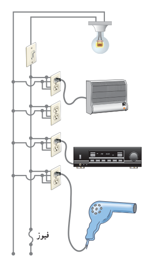

### مثال ۲ـ۱۴

یک لامپ رشته‌ای ۱۰۰ W، یک بخاری برقی ۲۰۰۰ W، یک دستگاه پخش صوت ۲۰۰ W، و یک سشوار (موخشک‌کن) ۲۲۰۰ W مطابق شکل به پریزهای یک مدار سیم‌کشی خانگی ۲۲۰ V وصل شده است.

الف) فیوز قطعه‌ای حفاظتی در مسیر سیم‌کشی‌های الکتریکی است که وقتی جریان الکتریکی بخواهد از حد مجاز بیشتر شود، جریان را قطع می‌کند. اگر فیوز شکل، ۱۵ A باشد، یعنی حداکثر بتواند جریان ۱۵ A را تحمل کند، آیا فیوز خواهد پرید؟

ب) نشان دهید توان الکتریکی مصرفی مقاومت معادل برابر با مجموع توان‌های الکتریکی مصرفی در هریک از آنهاست.

**پاسخ:** الف) همان‌طور که در شکل می‌بینیم در سیم‌کشی منازل همۀ مصرف‌کننده‌ها به‌طور موازی متصل می‌شوند. بنابراین، جریان کل عبوری از فیوز برابر با مجموع جریان‌های عبوری از هریک از مصرف‌کننده‌هاست. با استفاده از رابطۀ $I=P/V$ جریان عبوری از هریک از این چهار مصرف‌کننده را به‌دست می‌آوریم. بنابراین، به ترتیب داریم:

$$I_{\text{لامپ}}=\frac{P_{\text{لامپ}}}{V}=\frac{100\,\mathrm W}{220\,\mathrm V}=0/455\,\mathrm A$$
$$I_{\text{بخاری}}=\frac{P_{\text{بخاری}}}{V}=\frac{2000\,\mathrm W}{220\,\mathrm V}=9/09\,\mathrm A$$
$$I_{\text{پخش}}=\frac{P_{\text{پخش}}}{V}=\frac{200\,\mathrm W}{220\,\mathrm V}=0/909\,\mathrm A$$
$$I_{\text{سشوار}}=\frac{P_{\text{سشوار}}}{V}=\frac{2200\,\mathrm W}{220\,\mathrm V}=10/0\,\mathrm A$$

بنابراین، جریان کل عبوری از فیوز برابر است با:

$$I_{\text{فیوز}}=I_{\text{کل}}=I_{\text{لامپ}}+I_{\text{بخاری}}+I_{\text{پخش}}+I_{\text{سشوار}}$$
$$=0/455\,\mathrm A+9/09\,\mathrm A+0/909\,\mathrm A+10/0\,\mathrm A=20/5\,\mathrm A$$

چون فیوز ۱۵ A است، بنابراین، فیوز نشان داده شده در شکل، خواهد پرید. در اغلب منازل چند مدار سیم‌کشی جداگانه داریم که هریک فیوز مربوط به خود را دارد. برای اینکه بتوانیم به‌طور هم‌زمان از چند وسیلۀ برقی استفاده کنیم، باید وسایل برقی را به‌طور هم‌زمان به یک مدار وصل نکنیم و مدارهای دیگر را نیز به کار گیریم.

ب) دیدیم که همۀ مصرف‌کننده‌ها به‌طور موازی متصل می‌شوند. بنابراین، مقاومت معادل مصرف‌کننده‌های شکل از رابطۀ ۲ـ۱۳ به‌دست می‌آید. بنابراین، برای محاسبۀ مقاومت لازم است مقاومت هریک از وسیله‌ها را به‌طور جداگانه محاسبه کنیم. مقاومت هر مصرف‌کننده با استفاده از رابطۀ $P=V^2/R$ به‌دست می‌آید. بنابراین، به ترتیب داریم:

$$R_{\text{لامپ}}=\frac{V^2}{P_{\text{لامپ}}}=\frac{(220\,\mathrm V)^2}{100\,\mathrm W}=484\,\Omega$$
$$R_{\text{بخاری}}=\frac{V^2}{P_{\text{بخاری}}}=\frac{(220\,\mathrm V)^2}{2000\,\mathrm W}=24/2\,\Omega$$
$$R_{\text{پخش}}=\frac{V^2}{P_{\text{پخش}}}=\frac{(220\,\mathrm V)^2}{200\,\mathrm W}=242\,\Omega$$
$$R_{\text{سشوار}}=\frac{V^2}{P_{\text{سشوار}}}=\frac{(220\,\mathrm V)^2}{2200\,\mathrm W}=22/0\,\Omega$$
