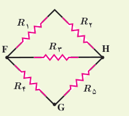
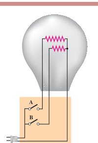

پس مقاومت معادل چنین محاسبه می‌شود:

$$\frac1{R_{eq}}=\frac1{R_{\text{لامپ}}}+\frac1{R_{\text{بخاری}}}+\frac1{R_{\text{پخش}}}+\frac1{R_{\text{سشوار}}}$$
$$=\frac1{484\,\Omega}+\frac1{24/2\,\Omega}+\frac1{242\,\Omega}+\frac1{22/0\,\Omega}=0/0930\,\Omega^{-1}$$

و در نتیجه $R_{eq}=10/75\,\Omega\approx10/8\,\Omega$. بنابراین، توان مصرفی مقاومت معادل چنین می‌شود:

$$P_{R_{eq}}=\frac{V^2}{R_{eq}}=\frac{(220\,\mathrm V)^2}{10/75\,\Omega}=4/50\,\mathrm{kW}$$

اکنون می‌خواهیم این نتیجه را با مجموع توان‌های هریک از مصرف‌کننده‌ها مقایسه کنیم. مجموع توان مصرف‌کننده‌ها برابر است با:

$$P_{\text{کل}}=P_{\text{لامپ}}+P_{\text{بخاری}}+P_{\text{پخش}}+P_{\text{سشوار}}=100\,\mathrm W+2000\,\mathrm W+200\,\mathrm W+2200\,\mathrm W=4500\,\mathrm W$$

که همان توان مصرفی مقاومت معادل است.

### تمرین ۲ـ۷

شکل روبه‌رو پنج مقاومت ۸/۰۰ اهمی را نشان می‌دهد. الف) مقاومت معادل بین نقطه‌های F و H چقدر است؟ ب) مقاومت معادل بین نقطه‌های F و G چقدر است؟

### مثال ۲ـ۱۵

یک لامپ سه‌راهۀ ۲۲۰ V که دو رشته دارد مطابق شکل برای کار در سه توان مختلف ساخته شده است. کمترین و بیشترین توان مصرفی این لامپ به ترتیب ۵۰/۰ W و ۱۵۰ W است. مقاومت هریک از رشته‌ها را بیابید.

**پاسخ:** همان‌طور که می‌دانیم توان الکتریکی مصرفی از رابطۀ $P=V^2/R$ به‌دست می‌آید. بنابراین، بیشترین توان مربوط به کمترین مقاومت و کمترین توان مربوط به بیشترین مقاومت است. در بستن موازی مقاومت‌ها دیدیم مقاومت معادل کوچک‌تر از هریک از مقاومت‌هاست. بنابراین، بیشترین توان مربوط به وقتی است که کلیدهای a و b هر دو بسته‌اند؛ یعنی:

$$\frac1{R_{eq}}=\frac1{R_1}+\frac1{R_2}$$

که در آن $R_1$ و $R_2$ مقاومت‌های دو رشتۀ لامپ‌اند. بنابراین، برای مقاومت معادل داریم:

$$R_{eq}=R_{min}=\frac{V^2}{P_{max}}=\frac{(220\,\mathrm V)^2}{150\,\mathrm W}=322/7\,\Omega$$
