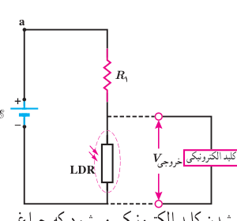

از طرفی کمترین توان مربوط به وقتی است که کلید مربوط به رشته با مقاومت بیشتر بسته شده است. اگر این مقاومت را با $R_1$ نمایش دهیم، داریم:

$$R_1=R_{max}=\frac{V^2}{P_{min}}=\frac{(220\,\mathrm V)^2}{50/0\,\mathrm W}=968\,\Omega$$

بنابراین، مقاومت مجهول $R_2$ از رابطۀ زیر به‌دست می‌آید:

$$\frac1{R_2}=\frac1{R_{eq}}-\frac1{R_1}=\frac1{322/7\,\Omega}-\frac1{968\,\Omega}=2/066\times10^{-3}\,\Omega^{-1}$$

در نتیجه

$$R_2=\frac1{2/066\times10^{-3}\,\Omega^{-1}}=484\,\Omega$$

### مثال ۲ـ۱۶

در بسیاری از مدارهای الکتریکی از تغییر مقاومت برای تقسیم ولتاژ استفاده می‌کنند. از این ویژگی در برخی از تجهیزات الکتریکی به‌عنوان کلید الکترونیکی بهره‌برداری می‌شود. آژیر خطر، کلید خودکار روشن شدن چراغ‌ها و ... مثال‌هایی از این دست هستند. شکل روبه‌رو چنین مداری را که در چراغ روشنایی خودروها به‌کار می‌رود، نشان می‌دهد. در این مدار از دو مقاومت $R_1$ و مقاومت متغیر LDR استفاده شده است که به‌طور متوالی به هم وصل‌اند. همان‌طور که می‌دانیم وقتی تابش نور به LDR قطع می‌شود، مقاومت آن افزایش می‌یابد. در نتیجه ولتاژ خروجی ($V_{\text{خروجی}}$) زیاد می‌شود. این افزایش ولتاژ سبب فعال شدن کلید الکترونیکی می‌شود که چراغ را در مدار دیگری روشن می‌کند. بنابراین تا زمانی که نور به اندازۀ کافی بتابد، کلید فعال نمی‌شود. فرض کنید در شکل بالا، منبع نیروی محرکه آرمانی و ولتاژ آن ۱۲/۰ V باشد و ولتاژ موردنیاز برای فعال شدن کلید الکترونیکی ۵/۰۰ V باشد. وقتی مقاومت LDR به $200\,\mathrm{k\Omega}$ می‌رسد، کلید الکترونیکی فعال می‌شود. مقاومت $R_1$ چقدر است؟ (مقاومت کلید الکترونیکی آن‌قدر زیاد است که جریان قابل ملاحظه‌ای از آن عبور نمی‌کند. بنابراین می‌توانیم $R_1$ و LDR را متوالی در نظر بگیریم.)

**پاسخ:** با استفاده از قاعدۀ حلقه داریم:

$$I=\frac{\mathcal E}{R_1+R_{LDR}}$$

از طرفی بدیهی است

$$V_{\text{خروجی}}=R_{LDR}I$$

از ترکیب دو معادله بالا خواهیم داشت:

$$V_{\text{خروجی}}=R_{LDR}\frac{\mathcal E}{R_1+R_{LDR}}$$

و از آنجا برای $R_1$ چنین به‌دست می‌آوریم:

$$R_1=\frac{R_{LDR}(\mathcal E-V_{\text{خروجی}})}{V_{\text{خروجی}}}=\frac{(200\,\mathrm{k\Omega})(12/0\,\mathrm V-5/00\,\mathrm V)}{5/00\,\mathrm V}=280\,\mathrm{k\Omega}$$
