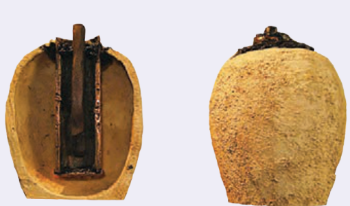

### خوب است بدانید: باتری اشکانی

اولین نشانۀ چگونگی تولید الکتریسیته در اواخر قرن هجدهم میلادی را به دانشمند ایتالیایی، لوئیجی گالوانی نسبت می‌دهند. گالوانی با یک مشاهدۀ معمولی، ولی کاملاً اتفاقی به پدیدۀ الکتریسیتۀ جاری در مقابل الکتریسیتۀ ساکن، پی برد. هموطن وی الکساندر ولتا دستگاهی براساس تجربۀ گالوانی اختراع کرد که در تاریخ به‌عنوان اولین باتری الکتریکی ثبت گردید و پیل ولتا لقب گرفت و از آن پس به‌عنوان منبع الکتریسیته به‌کار گرفته شد.

بیش از یک قرن پس از اختراع ولتا، کشف یک ظرف کوچک در نزدیکی بغداد در سال ۱۹۳۶ میلادی، این احتمال را قوت بخشید که ولتا اولین مخترع باتری نبوده بلکه آن را مجدداً اختراع کرده است. استخراج این ظرف به همراه سایر یافته‌های باستانی موجب شد تا ویلهلم کونینگ¹ باستان‌شناس اتریشی، فرضیۀ جسورانه‌ای را مبنی بر ساخت باتری در دورۀ اشکانیان، در سال ۱۹۳۸ ارائه نماید.

این باتری شامل ظرف سفالی کوچک، با ارتفاع ۱۴ و قطر ۸ سانتی‌متر، و یک استوانۀ مسی و یک میلۀ آهنی باریک بود که در نزدیکی شهر تیسفون کشف شد. از آنجایی که این محدوده، یک منطقۀ مسکونی اشکانی در دورۀ اشکانیان بوده است، باستان‌شناسان این یافته را متعلق به دوران امپراطوری اشکانیان دانسته و این باتری، باتری اشکانی یا باتری بغداد، نامیده شد.

دریچۀ تنگ و توخالی این ظرف سفالی، با درپوشی از جنس قیر پوشیده شده بود و استوانه‌ای که از جنس مس به شکل لوله درآمده بود، در پایین به یک صفحۀ مسی متصل شده و با قیر در مکان خود محکم شده و میلۀ آهنی کاملاً زنگ زده بود. برخی از باستان‌شناسان مانند ویلهلم کونینگ، معتقد بودند که آنها اجزای یک باتری الکتریکی هستند و چنین استنتاج نمودند که اگر تعدادی از آنها به هم متصل شوند، توان الکتریکی کافی برای آبکاری لایه‌های طلا روی اشیای فلزی را دارند. این آبکاری به‌منظور ارتقای کیفی و افزایش بهای آنها انجام می‌شده است.

هنگامی که مدلی از این باتری، با سولفات مس، سرکه و یا حتی آب گریپ‌فروت ترش به‌عنوان محلول الکترولیت پر شد، مشاهده شد که این مجموعه می‌تواند اختلاف پتانسیل مناسبی تولید کند و براساس این مشاهدات نظرات متنوعی مطرح شد. البته همۀ دانشمندان با کاربرد این یافتۀ باستانی به‌عنوان یک منبع تغذیه که زرگران اشکانی برای آبکاری طلا از آن استفاده می‌کردند، موافق نبودند. برخی از آنها اعتقاد داشته و دارند که احتمالاً این باتری، یک منبع آمادۀ الکتریکی و یا وسیله‌ای مشابه برای دادن شوک الکتریکی به بیماران بوده است.

پس از کشف این یافته‌های باستانی، تا امروز، دانشمندان زیادی تحقیقات گسترده‌ای روی انواع مدل‌های شبیه‌سازی شده از آن، جهت تأیید و یا رد فرضیۀ کونینگ انجام داده‌اند.

۱ـ Wilhelm Konig
