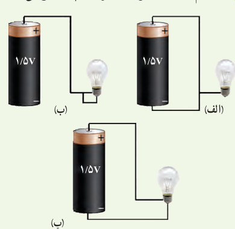
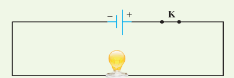
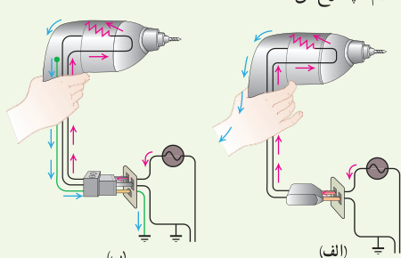
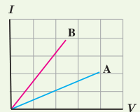

# پرسش‌ها و مسئله‌های فصل ۲

## ۲ـ۱ و ۲ـ۲ جریان الکتریکی، مقاومت الکتریکی و قانون اهم

**۱** در کدام یک از شکل‌های زیر، لامپ روشن می‌شود؟

**۲** در مدار شکل زیر اختلاف پتانسیل دو سر لامپ ۴/۰ V و مقاومت آن ۵/۰ Ω است. در مدت ۵ دقیقه چه تعداد الکترون از لامپ می‌گذرد؟

**۳** بررسی کنید اگر متۀ برقی (دریل) معیوب شکل‌های زیر را با دوشاخه (شکل الف) یا سه‌شاخه (شکل ب) به پریز وصل کنیم، چه رخ می‌دهد؟

**۴** آذرخش مثالی جالب از جریان الکتریکی در پدیده‌های طبیعی است. در یک آذرخش نوعی $1/0\times10^9\,\mathrm J$ انرژی تحت اختلاف پتانسیل $5/0\times10^7\,\mathrm V$ در بازۀ زمانی $0/20\,\mathrm s$ آزاد می‌شود. با استفاده از این اطلاعات الف) مقدار بار کل منتقل‌شده بین ابر و زمین، ب) جریان متوسط در یک بورش آذرخش و پ) توان متوسط آزادسازی این انرژی در ۰/۲۰ s را به‌دست آورید.

**۵** در آزمایش تحقیق قانون اهم، نتایج جدول زیر به‌دست آمده است.

| شمارۀ آزمایش | عدد ولت‌سنج (V) | عدد آمپرسنج (A) |
|---:|---:|---:|
| ۱ | صفر | صفر |
| ۲ | ۱/۶ | ۰/۱۶ |
| ۳ | ۴/۴ | ۰/۴۳ |
| ۴ | ۷/۰ | ۰/۶۸ |
| ۵ | ۹/۰ | ۰/۷۲ |
| ۶ | ۱۰/۰ | ۰/۷۵ |

نمودار ولتاژ برحسب جریان را رسم کنید و با فرض ثابت ماندن دما تعیین کنید در چه محدوده‌ای رفتار این مقاومت از قانون اهم پیروی می‌کند.

**۶** شکل زیر نمودار $I-V$ را برای دو رسانای A و B نشان می‌دهد. مقاومت کدام‌یک بیشتر است؟ چرا؟

## ۲ـ۳ عوامل مؤثر بر مقاومت الکتریکی

**۷** دو رسانای فلزی از یک ماده ساخته شده‌اند و طول یکسانی دارند. رسانای A سیم توپر به قطر ۱/۰ mm است. رسانای B لوله‌ای توخالی به شعاع خارجی ۲/۰ mm و شعاع داخلی ۱/۰ mm است. مقاومت رسانای A چند برابر مقاومت رسانای B است؟

**۸** در ماشین‌های چمن‌زنی برقی برای مسافت‌های حداکثر تا ۳۵ m از سیم‌های مسی نمرۀ ۲۰ (قطر ۰/۰۸ cm) و برای مسافت‌های طولانی‌تر از سیم‌های ضخیم‌تر نمرۀ ۱۶ (قطر ۰/۱۳ cm) استفاده می‌کنند تا بدین ترتیب مقاومت سیم را تا آنجا که ممکن است کوچک نگه دارند. الف) مقاومت یک سیم ۳۰ متری ماشین چمن‌زنی چقدر است؟ ب) مقاومت یک
