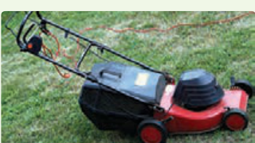
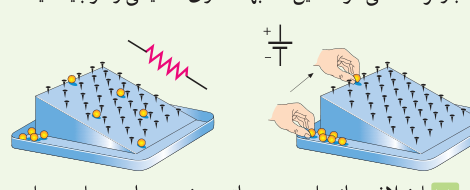
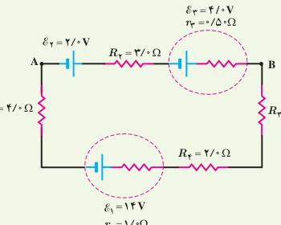
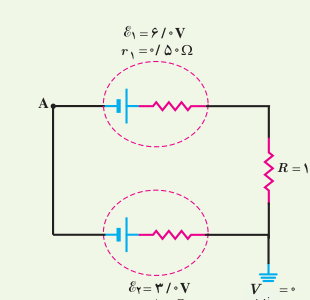
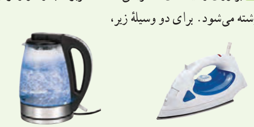

سیم ۷۰ متری ماشین چمن‌زنی چقدر است؟ (دمای سیم‌ها را ۲۰°C در نظر بگیرید.)

**۹** مقاومت رشتۀ درونی یک برشته‌کن که از جنس نیکروم است، در حالت روشن (دمای ۱۲۰۰°C) برابر ۴۴ Ω است. مقاومت این رشته در دمای ۲۰°C چقدر است؟ (از تغییر طول و قطر رشته در اثر تغییر دما چشم‌پوشی شود.)

## ۲ـ۴ نیروی محرکۀ الکتریکی و مدارها

**۱۰** شکل زیر یک مشابهت‌سازی مکانیکی برای درک مقاومت و نیروی محرکۀ الکتریکی را نشان می‌دهد که در آن بر سطح شیب‌داری میخ‌هایی تعبیه شده و تیله‌ها از ارتفاع بالای سطح شیب‌دار رها می‌شوند و سپس دوباره به بالای سطح شیب‌دار بازگردانده می‌شوند. این مشابهت‌سازی مکانیکی را توجیه کنید.

**۱۱** اختلاف پتانسیل دو سر باتری خودروهای سواری برابر ۱۲ ولت است. اگر هشت باتری قلمی ۱/۵ ولتی را به‌طور متوالی به یکدیگر وصل کنیم، اختلاف پتانسیل دو سر مجموعۀ آنها نیز برابر ۱۲ ولت می‌شود. توضیح دهید چرا در خودروها به جای باتری خودرو از هشت باتری قلمی استفاده نمی‌شود.

**۱۲** یک باتری را در نظر بگیرید که وقتی به مدار بسته نیست اختلاف پتانسیل دو سرش برابر ۱۲/۰ V است. وقتی یک مقاومت ۱۰/۰ Ω به این باتری بسته شود، اختلاف پتانسیل دو سر باتری به ۱۰/۹ V کاهش می‌یابد. مقاومت داخلی باتری چقدر است؟

**۱۳** در مدار شکل زیر جریان در مدار و اختلاف پتانسیل بین دو نقطۀ A و B ($V_B-V_A$) را محاسبه کنید.

**۱۴** در شکل زیر الف) اختلاف پتانسیل دوسر منبع‌های نیروی محرکه را به‌دست آورید. ب) پتانسیل نقطۀ A را تعیین کنید.

## ۲ـ۵ توان در مدارهای الکتریکی

**۱۵** دو لامپ رشته‌ای در اختیار داریم که جنس و طول رشتۀ آنها یکسان است، ولی رشتۀ لامپ B ضخیم‌تر از رشتۀ لامپ A است. وقتی لامپ‌ها به ولتاژ یکسانی وصل شوند، کدام لامپ پرنورتر خواهد بود و چرا؟

**۱۶** بر روی وسیله‌های الکتریکی، اعداد مربوط به ولتاژ و توان نوشته می‌شود. برای دو وسیلۀ زیر، الف) سیم‌های اتصال به برق آنها باید بتواند حداقل چه جریانی را از خود عبور دهد؟ ب) مقاومت الکتریکی هر وسیله در حالت روشن چقدر است؟

