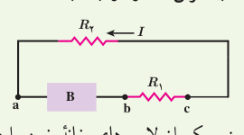
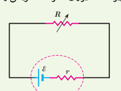
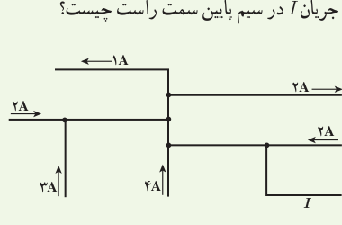
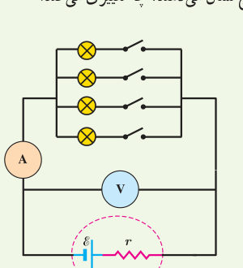

**۱۷** لامپ یک چراغ‌قوۀ معمولی با ولتاژ ۲/۹ V کار می‌کند و در این حالت توان مصرفی آن ۰/۸۷ W می‌شود. اگر مقاومت رشتۀ تنگستنی این لامپ در دمای اتاق (۲۰°C) برابر ۱/۱ Ω باشد، دمای این رشته وقتی که لامپ روشن است، چقدر می‌شود؟

**۱۸** شکل زیر جریان $I$ را در یک مدار تک‌حلقه‌ای با باتری B و مقاومت‌های $R_1$ و $R_2$ (و سیم‌هایی با مقاومت ناچیز) نشان می‌دهد. الف) علامت پایانه‌های باتری B را مشخص کنید. در نقاط a، b و c، ب) بزرگی جریان، پ) پتانسیل الکتریکی و ت) انرژی پتانسیل الکتریکی حامل‌های بار مثبت را به‌گونه‌ای مرتب کنید که بیشترین مقدار در ابتدا باشد.

**۱۹** تلویزیون و یکی از لامپ‌های خانۀ خود را در نظر بگیرید و فرض کنید که هرکدام روزی ۸ ساعت با اختلاف پتانسیل ۲۲۰ ولت روشن باشند. الف) انرژی الکتریکی مصرفی هرکدام در یک دورۀ یک‌ماهه (۳۰ روز) چند kWh است؟ (توان مصرفی هر وسیله را از روی آن بخوانید.) ب) بهای برق مصرفی هر کدام از قرار هر کیلووات ساعت ۵۰ تومان در یک دورۀ یک‌ماهه چقدر می‌شود؟ پ) اگر در شهر شما هر خانه یک لامپ ۱۰۰ وات اضافی را به مدت ۳ ساعت در شب روشن کند، در طول یک ماه تقریباً چند کیلووات ساعت انرژی الکتریکی اضافی مصرف می‌شود؟

**۲۰** در شکل زیر، الف) نیروی محرکۀ الکتریکی و مقاومت داخلی منبع را که توان خروجی آن به ازای $I_1=5/00\,\mathrm A$ برابر ۹/۵۰ W و به ازای $I_2=7/00\,\mathrm A$ برابر ۱۲/۶ W است، محاسبه کنید. ب) نمودار اختلاف پتانسیل دو سر باتری برحسب جریان گذرنده از آن را رسم کنید.

## ۲ـ۶ ترکیب مقاومت‌ها

**۲۱** به‌نظر شما چرا چراغ‌های خودرو (چراغ‌های جلو، عقب و ...)، به‌طور موازی بسته می‌شوند؟

**۲۲** مقاومت یک آمپرسنج برای اندازه‌گیری جریان در یک مدار باید چگونه باشد تا جریان اندازه‌گیری‌شده توسط آمپرسنج با جریان قبل از قرار دادن آمپرسنج، نزدیک به هم باشد؟

**۲۳** شکل زیر بخشی از یک مدار را نشان می‌دهد. بزرگی و جهت جریان $I$ در سیم پایین سمت راست چیست؟

**۲۴** در شکل زیر، تعدادی لامپ مشابه به طور موازی به هم متصل شده‌اند و هر لامپ با کلیدی همراه است. بررسی کنید که با بستن کلیدها یکی پس از دیگری، عددهایی که آمپرسنج و ولت‌سنج نشان می‌دهند، چه تغییری می‌کند؟

**۲۵** دو لامپ با مقاومت مساوی $R$ را یک بار به‌طور متوالی و بار دیگر به‌طور موازی به یکدیگر می‌بندیم و آنها را هر بار به ولتاژ $V$ وصل می‌کنیم. نسبت توان مصرف‌شده در حالت موازی به توان مصرف‌شده در حالت متوالی چقدر است؟

**۲۶** در شکل‌های صفحۀ بعد، آیا مقاومت‌ها به‌طور متوالی بسته شده‌اند یا موازی و یا هیچ کدام؟
