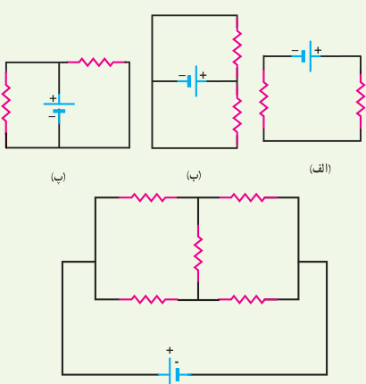
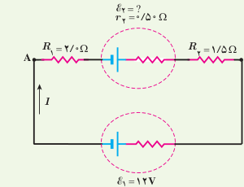
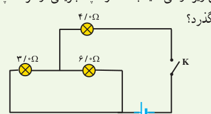
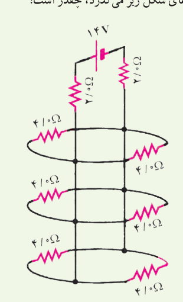
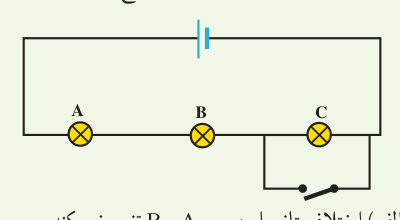

**۲۷** در مدار شکل زیر جریان در جهت نشان داده شده ۱/۲ A است. الف) نیروی محرکۀ $\mathcal E_2$ و $V_A-V_B$ چقدر است؟ ب) انرژی مصرف‌شده در $R_1$ و $R_2$ در مدت ۵/۰ ثانیه چقدر است؟

**۲۸** سه مقاومت مشابه ۱۲ اهمی را یک‌بار به‌طور متوالی و بار دیگر به‌طور موازی به یکدیگر می‌بندیم و به اختلاف پتانسیل ۱۲ ولت وصل می‌کنیم. در هر بار، چه جریانی از هر مقاومت می‌گذرد؟

**۲۹** دو مقاومت موازی ۶/۰ اهمی و ۱۲ اهمی به‌طور متوالی به یک مقاومت ۲/۰ اهمی وصل شده است. اکنون، مجموعۀ مقاومت‌ها را به دو سر یک باتری آرمانی ۳۶ ولتی می‌بندیم. توان مصرفی در مقاومت ۶/۰ اهمی را محاسبه کنید.

**۳۰** در شکل زیر، وقتی کلید بسته شود چه جریانی از هر لامپ رشته‌ای می‌گذرد؟

**۳۱** جریانی که از منبع نیروی محرکۀ آرمانی و هریک از مقاومت‌های شکل زیر می‌گذرد، چقدر است؟

**۳۲** لامپ‌های A، B و C در شکل زیر همگی یکسان‌اند. با بستن کلید، کدام‌یک از تغییرات زیر در اختلاف پتانسیل رخ می‌دهد؟ (ممکن است بیش از یک پاسخ درست باشد.)

الف) اختلاف پتانسیل دو سر A و B تغییر نمی‌کند. ب) اختلاف پتانسیل دو سر C به اندازۀ ۵۰٪ کاهش می‌یابد. پ) هریک از اختلاف پتانسیل‌های دو سر A و B به اندازۀ ۵۰٪ افزایش می‌یابد. ت) اختلاف پتانسیل دو سر C به صفر کاهش می‌یابد.

**۳۳** در سیم‌کشی منازل، همۀ مصرف‌کننده‌ها به‌طور موازی متصل می‌شوند. یک اتوی ۱۱۰۰ W، یک نان برشته‌کن (توستر) ۱۸۰۰ W، پنج لامپ رشته‌ای ۱۰۰ W و یک بخاری ۱۱۰۰ W به یک مدار سیم‌کشی خانگی ۲۲۰ V که فیوز آن حداکثر می‌تواند جریان ۱۵ A را تحمل کند وصل شده‌اند. آیا این ترکیب مصرف‌کننده‌ها باعث پریدن این فیوز می‌شود یا خیر؟
