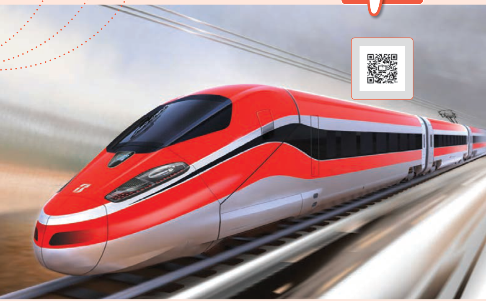

# فصل ۳: مغناطیس

### پرواز مغناطیسی یا ترابری مگ‌لو¹

قطارهای معمولی با ریل‌های آهنی در تماس‌اند؛ درحالی‌که قطارهای مغناطیسی هنگام حرکت، چند سانتی‌متر بالاتر از ریل‌ها شناور می‌شوند و با ریل‌ها تماس ندارند. تندی این قطارها امروزه به بیش از ۵۰۰ کیلومتر بر ساعت (حدود ۱۴۰ متر بر ثانیه) رسیده است.

۱ـ مگ‌لو (Maglev) کوتاه‌نوشت عبارت شناوری مغناطیسی (Magnetic Levitation) است.
