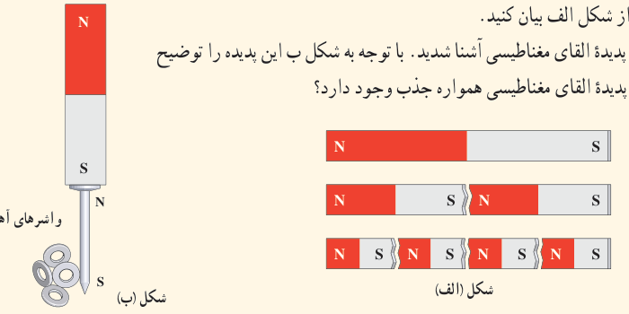
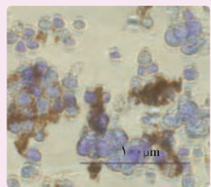
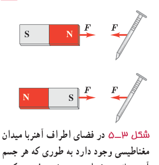
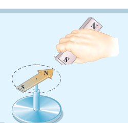

### پرسش ۳ـ۲

۱ـ دریافت خود را از شکل الف بیان کنید.

۲ـ در علوم هشتم با پدیدۀ القای مغناطیسی آشنا شدید. با توجه به شکل ب این پدیده را توضیح دهید و بیان کنید چرا در پدیدۀ القای مغناطیسی همواره جذب وجود دارد؟

### فناوری و کاربرد: نانوذره‌های مغناطیسی برای درمان

لکه‌های تیره در تصویر میکروسکوپی روبه‌رو، یاخته‌های سرطانی‌اند که از توموری جدا شده‌اند و خطر پخش آنها در سراسر بدن بیمار وجود دارد. در یک روش تجربی برای مبارزه با این یاخته‌ها از ذره‌های یک مادۀ مغناطیسی استفاده می‌شود که به بدن تزریق می‌شوند. این ذره‌ها با مادۀ شیمیایی خاصی پوشیده شده‌اند که به‌طور هدفمند به یاخته‌های سرطانی متصل می‌شوند. سپس با استفاده از یک آهن‌ربا در بیرون از بدن بیمار، این ذره‌ها (که در شکل به رنگ قهوه‌ای نشان داده شده است) بیرون «رانده» می‌شوند و یاخته‌های سرطانی را با خود می‌برند.

## ۳ـ۲ میدان مغناطیسی

هرگاه آهن‌ربایی را به یک میخ آهنی نزدیک کنید می‌بینید که میخ به طرف آهن‌ربا حرکت می‌کند و به سمت آن جذب می‌شود (شکل ۳ـ۵). مشابه آنچه دربارۀ اجسام باردار دیدید، برای توجیه این پدیده می‌گوییم در فضای اطراف آهن‌ربا میدان مغناطیسی وجود دارد که سبب جذب میخ شده است. میدان مغناطیسی نیز مانند میدان الکتریکی که در فصل ۱ با آن آشنا شدید، کمیتی برداری است و آن را با نماد $\vec B$ نمایش می‌دهیم.

شکل ۳ـ۵ در فضای اطراف آهن‌ربا میدان مغناطیسی وجود دارد به‌طوری که هر جسم آهنی مانند میخ را به سوی خود جذب می‌کند.

### فعالیت ۳ـ۱

یکی از قطب‌های یک آهن‌ربای میله‌ای را به یک عقربۀ مغناطیسی نزدیک کنید (شکل روبه‌رو). آنچه را می‌بینید توضیح دهید. با دور کردن آهن‌ربا از قطب‌نما چه اتفاقی می‌افتد؟ دلیل آن را شرح دهید. درصورتی که قطب‌نما در اختیار ندارید، یک سوزن ته‌گرد مغناطیسی شده را روی سطح آب، درون ظرفی شناور سازید. به این ترتیب، سوزن ته‌گرد مانند عقربۀ مغناطیسی یک قطب‌نما رفتار می‌کند.

