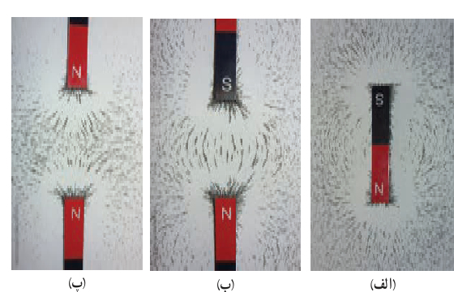
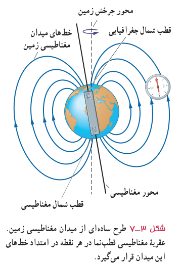

## آزمایش ۳ـ۱

**هدف: مشاهدۀ طرح خط‌های میدان مغناطیسی با استفاده از برادۀ آهن**

**وسیله‌های مورد نیاز:** آهن‌ربای میله‌ای (دو عدد)، برادۀ آهن، یک ورقۀ شیشه‌ای یا مقوایی، نمک‌پاش (یا وسیلۀ دیگری برای پاشیدن برادۀ آهن)، و دوربین برای عکس گرفتن از نتیجۀ آزمایش (اختیاری)

**شرح آزمایش:**

• یکی از آهن‌رباهای میله‌ای را روی میز قرار دهید و صفحۀ شیشه‌ای (یا مقوایی) را روی آن بگذارید.

• به کمک نمک‌پاش، کمی برادۀ آهن را به‌طور یکنواخت روی شیشه (مقوا) بپاشید.

• چند ضربۀ آرام به صفحۀ شیشه‌ای بزنید تا براده‌های آهن در راستای خط‌های میدان مغناطیسی قرار گیرند. طرحی که روی صفحۀ شیشه‌ای پدیدار می‌شود، نقشه‌ای از خط‌های میدان مغناطیسی یک آهن‌ربای میله‌ای است (شکل الف).

• مراحل بالا را برای دو آهن‌ربای میله‌ای که به‌ترتیب: قطب‌های ناهمنام و قطب‌های همنام آنها به یکدیگر نزدیک‌اند انجام دهید (شکل‌های ب و پ).

**میدان مغناطیسی زمین:** زمین مانند یک آهن‌ربای بسیار بزرگ رفتار می‌کند و طرح خط‌های میدان مغناطیسی آن مانند طرح خط‌های آهن‌ربای میله‌ای بزرگی است که در نزدیکی مرکز زمین قرار دارد و قطب شمال آن در نزدیکی قطب جنوب جغرافیایی زمین است (شکل ۳ـ۷). نشان دادن خط‌های میدان مغناطیسی زمین به صورت خط‌های میدان یک آهن‌ربای میله‌ای، تنها یک مدل ساده از ساختار پیچیده و ناشناختۀ عوامل ایجاد میدان مغناطیسی زمین است. شواهد زمین‌شناختی نشان می‌دهند که جهت این میدان در بازه‌های زمانی نامنظم از ده هزار تا یک‌میلیون سال به‌طور کامل وارون می‌شود. قطب‌های مغناطیسی زمین بر قطب‌های جغرافیایی آن منطبق نیستند. در واقع، قطب‌های مغناطیسی و جغرافیایی زمین فاصلۀ نسبتاً زیادی از یکدیگر دارند؛ مثلاً قطب جنوب مغناطیسی تقریباً در فاصلۀ ۱۸۰۰ کیلومتری قطب شمال جغرافیایی قرار دارد. این بدان معناست که عقربۀ مغناطیسی قطب‌نما در جهت شمال واقعی جغرافیایی قرار نمی‌گیرد و تا حدودی از شمال جغرافیایی انحراف دارد.

شکل ۳ـ۷ طرح ساده‌ای از میدان مغناطیسی زمین. عقربۀ مغناطیسی قطب‌نما در هر نقطه در امتداد خط‌های این میدان قرار می‌گیرد.
