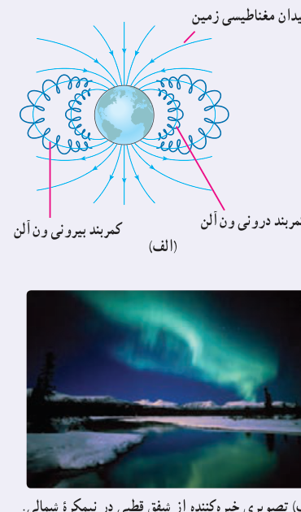
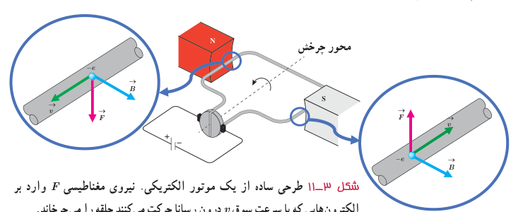

### خوب است بدانید: کمربندهای تابشی ون آلن

در بیرون از جوّ زمین، ذره‌های باردار بسیاری با تندی‌های بسیار زیادی در حرکت‌اند. این ذره‌های سریع را که معمولاً از جنس پروتون، هستۀ اتم هلیم (ذرۀ آلفا) و الکترون هستند پرتوهای کیهانی می‌نامند. این پرتوها افزون بر فضانوردان، برای سامانه‌های الکترونیکی واقع در فضا نیز خطرناک‌اند. خوشبختانه بیشتر این پرتوهای باردار توسط میدان مغناطیسی زمین منحرف می‌شوند و مانع از آسیب‌رسانی به موجودات و سامانه‌های روی زمین می‌شود. ذرات بارداری که در میدان مغناطیسی زمین به دام می‌افتند، کمربندهای تابشی ون آلن را تشکیل می‌دهند (شکل الف).

این کمربندها در سال ۱۹۵۸ میلادی و بر اساس داده‌های گردآوری شده توسط ماهوارۀ اکسپلورر ۱ کشف شده و به نام جیمز ون آلن (۱۹۱۴–۲۰۰۶) یکی از کاشفان آن، نام‌گذاری شدند. فضانوردان در فاصله‌های ایمن بسیار پایین‌تر از این کمربندهای تابشی دور زمین می‌گردند.

هرگاه توفان‌های خورشیدی، ذره‌های باردار را به صورت فوران‌های عظیمی پرتاب کنند، بسیاری از آنها از نزدیکی زمین می‌گذرند و در کمربند ون آلن به دام می‌افتند. شفق قطبی (نورهای شمالی) پدیدۀ زیبایی است که بر اثر برخورد ذره‌های باردار موجود در کمربند ون آلن با مولکول‌های جوّ زمین به‌وجود می‌آید (شکل ب).

الف) کمربند درونی و بیرونی ون آلن. ب) تصویری خیره‌کننده از شفق قطبی در نیمکرۀ شمالی. در نیمکرۀ جنوبی این پدیده شفق جنوبی نامیده می‌شود.

## ۳ـ۴ نیروی مغناطیسی وارد بر سیم حامل جریان

موتورهای الکتریکی ابزارهایی هستند که انرژی الکتریکی را به انرژی مکانیکی تبدیل می‌کنند و اساس کار بسیاری از دستگاه‌ها نظیر جاروبرقی، متۀ برقی، آسیاب برقی، ماشین لباسشویی، پنکه و... را تشکیل می‌دهند. شکل ۳ـ۱۱ طرحی ساده از اجزای اصلی یک موتور الکتریکی را نشان می‌دهد که در علوم سال هشتم با نحوۀ ساختن آن آشنا شدید. چه چیز باعث می‌شود یک موتور الکتریکی کار کند؟

شکل ۳ـ۱۱ طرحی ساده از یک موتور الکتریکی. نیروی مغناطیسی $\vec F$ وارد بر الکترون‌هایی که با سرعت سوق $v$ درون رسانا حرکت می‌کنند حلقه را می‌چرخاند.
