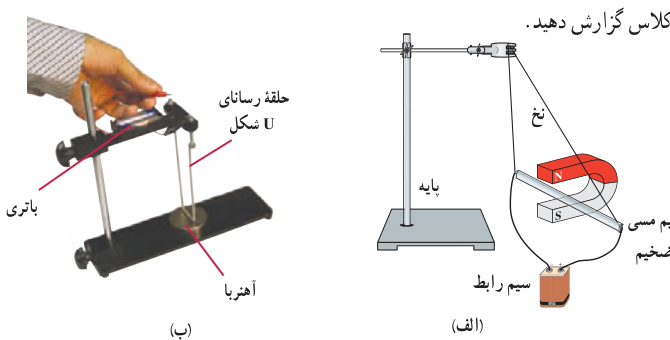
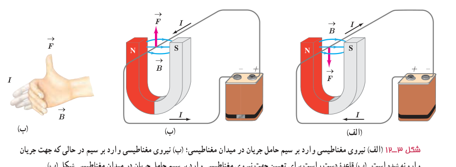

در هر موتور الکتریکی، سیم‌هایی وجود دارند که حامل جریان‌اند (یعنی بارهای الکتریکی در آنها در حرکت‌اند) و آهن‌رباهایی نیز وجود دارند که بر بارهای متحرک نیرو وارد می‌کنند. از این رو، بر هر سیم حامل جریان، نیروی مغناطیسی وارد می‌شود و این نیروها حلقه را می‌چرخانند.

## آزمایش ۳ـ۲

**هدف: بررسی نیروی وارد بر سیم حامل جریان**

**وسیله‌های مورد نیاز:** آهن‌ربای نعلی‌شکل، سیم مسی ضخیم، سیم رابط، پایه، نخ و باتری

**شرح آزمایش:**

• مداری مطابق شکل الف ببندید تا جریان از سیم مسی بگذرد. آنچه را که مشاهده می‌کنید، در گروه خود به بحث بگذارید.

• در صورتی که وسیله‌ای مشابه شکل ب را در آزمایشگاه مدرسه در اختیار دارید می‌توانید از آن استفاده کنید.

• مدار را قطع کنید و جهت جریان را تغییر داده و مراحل بالا را دوباره انجام دهید.

• نتیجۀ آزمایش را به کلاس گزارش دهید.

اورستد (فیزیک‌دان دانمارکی) با انجام آزمایش‌هایی شبیه آزمایش ۳ـ۲ و اندازه‌گیری نیرویی که بر سیم حامل جریان در میدان مغناطیسی وارد می‌شود، نشان داد:

نیرویی که در میدان مغناطیسی بر سیم حامل جریان الکتریکی وارد می‌شود، بر راستای سیم و نیز بر راستای میدان مغناطیسی عمود است. جهت نیروی وارد بر سیم حامل جریان در میدان مغناطیسی را می‌توان با استفاده از قاعدۀ دست راست تعیین کرد (شکل ۳ـ۱۲).

شکل ۳ـ۱۲ الف) نیروی مغناطیسی وارد بر سیم حامل جریان در میدان مغناطیسی؛ ب) نیروی مغناطیسی وارد بر سیم در حالی که جهت جریان وارونه شده است. پ) قاعدۀ دست راست برای تعیین جهت نیروی مغناطیسی وارد بر سیم حامل جریان در میدان مغناطیسی شکل ب.
