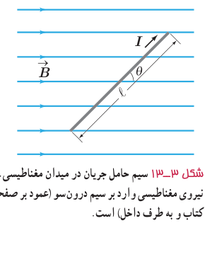
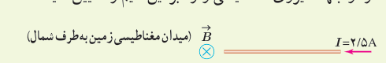

**عامل‌های مؤثر بر نیروی مغناطیسی وارد بر سیم راست رسانای حامل جریان:** آزمایش‌های مشابه آزمایش ۳ـ۲ نشان می‌دهند که نیروی مغناطیسی وارد بر یک سیم رسانای حامل جریان در میدان مغناطیسی یکنواخت، به عامل‌های مختلفی بستگی دارد که این عامل‌ها در رابطۀ زیر بیان شده‌اند:

$$F=I\ell B\sin\theta\tag{3-3}$$

در این رابطه $\ell$ طول بخشی از سیم رساناست که در میدان مغناطیسی یکنواخت $B$ قرار دارد. زاویه‌ای را که امتداد سیم با خطوط میدان مغناطیسی می‌سازد با $\theta$ نشان داده‌ایم (شکل ۳ـ۱۳).

شکل ۳ـ۱۳ سیم حامل جریان در میدان مغناطیسی. نیروی مغناطیسی وارد بر سیم درون‌سو (عمود بر صفحۀ کتاب و به طرف داخل) است.

### پرسش ۳ـ۵

اگر در شکل ۳ـ۱۳ سیم حامل جریان در امتداد میدان مغناطیسی قرار گیرد، نیروی مغناطیسی وارد بر آن چقدر خواهد بود؟ در چه حالتی بزرگی این نیرو بیشینه می‌شود؟

### مثال ۳ـ۲

یک سیم حامل جریان در میدان مغناطیسی یکنواختی به بزرگی ۴۰۰ G در راستایی قرار دارد که با جهت میدان زاویۀ ۳۰° می‌سازد. اگر جریان عبوری از سیم ۵/۰ A باشد، بزرگی نیروی مغناطیسی وارد بر ۱/۰ m از این سیم را حساب کنید.

**پاسخ:** با توجه به فرض‌های مسئله داریم:

$$B=400\times10^{-4}\,\mathrm T,\quad\theta=30^\circ,\quad I=5/0\,\mathrm A,\quad\ell=1/0\,\mathrm m$$

با قرار دادن داده‌های بالا در رابطۀ ۳ـ۳ داریم:

$$F=I\ell B\sin\theta=(5/0\,\mathrm A)(1/0\,\mathrm m)(400\times10^{-4}\,\mathrm T)\sin30^\circ=0/10\,\mathrm N$$

### تمرین ۳ـ۲

سیم مستقیمی به طول ۲/۴ m حامل جریان ۲/۵ A از شرق به غرب است. اندازۀ میدان مغناطیسی زمین در محل این سیم ۰/۴۵ G و جهت آن از جنوب به شمال است. اندازه و جهت نیروی مغناطیسی وارد بر این سیم را تعیین کنید.

### فعالیت ۳ـ۴

آزمایشی را طراحی کنید که به کمک آن بتوان نیروی مغناطیسی وارد بر سیم حامل جریان الکتریکی درون میدان مغناطیسی را اندازه‌گیری کرد. در صورت لزوم، برای اجرای این آزمایش می‌توانید از ترازوهای دیجیتال (رقمی) با دقت ۰/۰۱ g استفاده کنید.
