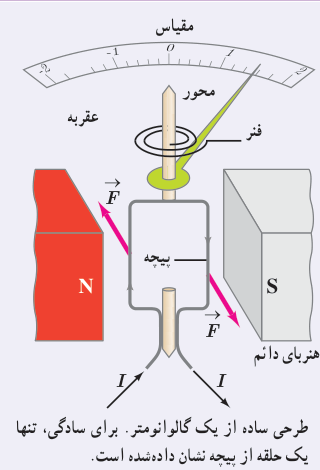
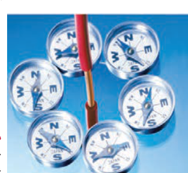

### خوب است بدانید: طرز کار گالوانومتر

گالوانومتر وسیله‌ای است که با آن می‌توان جریان‌های الکتریکی بسیار کوچک از مرتبۀ میکروآمپر را اندازه گرفت. با استفاده از مطالبی که تاکنون فراگرفته‌ایم، می‌توان ساز و کار گالوانومتر عقربه‌ای را مورد بررسی قرار داد.

هر گالوانومتر قابی دارد که دور آن سیمی پیچیده شده است. این پیچه در میدان مغناطیسی آهن‌ربای دائمی قرار دارد. وقتی جریان از پیچه می‌گذرد، میدان مغناطیسی با وارد کردن نیرو به سیم‌های حامل جریان، گشتاوری ایجاد می‌کند که پیچه را می‌چرخاند (شکل روبه‌رو) و عقربۀ متصل به پیچه منحرف می‌شود. هر قدر جریان بزرگ‌تر شود، چرخش پیچه و انحراف عقربه بیشتر خواهد شد. اگر جهت جریان وارون شود، جهت چرخش پیچه و انحراف عقربه نیز وارون خواهد شد. با قطع جریان، فنر ظریف نشان داده شده در شکل، پیچه و عقربه را به حالت اولیۀ خود برمی‌گرداند. صفحۀ گالوانومتر که عقربه در مقابل آن می‌چرخد را برحسب یکای میکروآمپر مدرج می‌کنند.

طرحی ساده از یک گالوانومتر. برای سادگی، تنها یک حلقه از پیچه نشان داده شده است.

## ۳ـ۵ میدان مغناطیسی حاصل از جریان الکتریکی

تا اینجا پی بردیم که در فضای اطراف آهن‌رباهای دائمی میدان مغناطیسی وجود دارد. در ادامۀ این فصل با چشمه‌های دیگر ایجاد میدان مغناطیسی آشنا خواهیم شد.

اورستد دانشمند دانمارکی، در سال ۱۸۲۰ میلادی ضمن انجام برخی آزمایش‌های الکتریسیته، مشاهده کرد که عقربۀ مغناطیسی در کنار سیم حامل جریان الکتریکی منحرف می‌شود (شکل ۳ـ۱۴). او با انجام دادن آزمایش‌های بیشتر کشف کرد که عبور جریان الکتریکی از یک سیم رسانا، در اطراف آن یک میدان مغناطیسی به‌وجود می‌آورد. این کشف اورستد گام مهمی در راه درک رابطۀ بین الکتریسیته و مغناطیس بود که به گسترش مبحث الکترومغناطیس انجامید. در این بخش، به بررسی میدان مغناطیسی حاصل از جریان الکتریکی در سیم‌ها می‌پردازیم.

شکل ۳ـ۱۴ میدان مغناطیسی اطراف سیم حامل جریان را می‌توان با قرار دادن تعدادی عقربۀ مغناطیسی پیرامون آن نشان داد.

### هانس کریستیان اورستد (۱۷۷۷–۱۸۵۱)

فیزیک‌دان و شیمی‌دان مشهور دانمارکی است که تأثیر بسیار بزرگی در تاریخ فیزیک گذاشته است. کشفیات وی در زمینۀ الکتریسیته و مغناطیس، اولین گام در شکل‌گیری نظریۀ الکترومغناطیس بود. اورستد که معمولاً در کلاس‌هایش به انجام آزمایش هم می‌پرداخت، در یکی از روزهای سال ۱۸۲۰ میلادی، در حالی که مشغول آموزش الکتریسیته و تولید جریان با پیل الکتریکی بود، متوجه انحراف جهت عقربۀ قطب‌نمایی شد که در کنار سیم حامل جریان قرار داشت. در ابتدا تصور کرد که ممکن است جریان هوای پیرامون سیم حامل جریان سبب انحراف عقربه شده است، اما با انجام آزمایش‌های دقیق‌تر، به ارتباط مستقیم الکتریسیته و مغناطیس پی برد. به دنبال این کشف مهم، دانشمندان دیگری همچون آمپر، فاراده، هانری، ماکسول و هرتز تحقیقات در الکترومغناطیس را ادامه دادند. اورستد در حوزۀ فلسفه هم مطالعاتی داشت و همچنین یکی از دوستان نزدیک داستان‌نویس مشهور کودکان، هانس کریستیان آندرسن بود.
