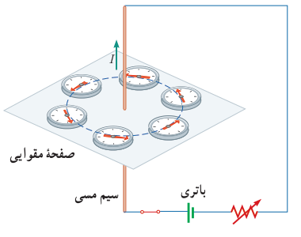
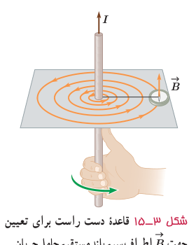
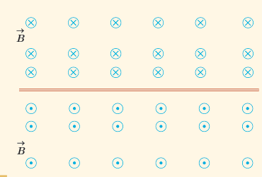

## آزمایش ۳ـ۳

**هدف: بررسی آثار مغناطیسی جریان الکتریکی (آزمایش اورستد)**

**وسیله‌های مورد نیاز:** باتری، سیم مسی نسبتاً ضخیم، صفحۀ مقوایی، عقربۀ مغناطیسی (قطب‌نما)، رئوستا و سیم رابط

**شرح آزمایش:**

• سیم مسی را از صفحۀ مقوایی بگذرانید و با آن مداری مطابق شکل روبه‌رو تشکیل دهید.

• قبل از برقراری جریان الکتریکی، عقربۀ مغناطیسی را در مجاورت سیم، روی مقوا قرار دهید و به راستای قرار گرفتن آن توجه کنید.

• با وصل کردن مدار، جریان الکتریکی را از سیم مسی عبور دهید و به جهت‌گیری عقربۀ مغناطیسی توجه کنید.

• عقربۀ مغناطیسی را در نقطه‌های مختلف روی مقوا قرار دهید و جهت آن را بررسی کنید.

• با توجه به جهت‌گیری عقربه در نقاط مختلف صفحۀ مقوایی، چند خط میدان مغناطیسی را رسم کنید.

• این آزمایش را بار دیگر با جریانی در جهت مخالف تکرار کنید.

• به کمک چند باتری دیگر یا تغییر مقاومت رئوستا، تحقیق کنید که افزایش یا کاهش جریان چه تأثیری در نتیجۀ آزمایش دارد؟

• نتیجۀ این آزمایش را در گروه خود بحث کنید و آن را به کلاس گزارش دهید.

با انجام این آزمایش می‌بینید که خط‌های میدان مغناطیسی حاصل از یک سیم حامل جریان، مطابق شکل ۳ـ۱۵ به صورت دایره‌های هم‌مرکز در اطراف سیم حامل جریان هستند. جهت خط‌های میدان مغناطیسی سیم مستقیم حامل جریان را می‌توان به کمک عقربۀ مغناطیسی تعیین کرد. علاوه بر آن، با استفاده از قاعدۀ دست راست نیز می‌توان این جهت را تعیین کرد؛ مطابق این قاعده، اگر سیم را در دست راست خود بگیرید به‌گونه‌ای که انگشت شست در جهت جریان الکتریکی باشد، جهت خم شدن چهار انگشت دست شما جهت خط‌های میدان مغناطیسی را در اطراف سیم نشان می‌دهد.

شکل ۳ـ۱۵ قاعدۀ دست راست برای تعیین جهت $\vec B$ اطراف سیم بلند مستقیم حامل جریان.

### پرسش ۳ـ۶

شکل روبه‌رو، جهت میدان مغناطیسی در اطراف یک سیم افقی و مستقیم حامل جریان را نشان می‌دهد. در ناحیۀ بالای سیم، جهت میدان مغناطیسی درون‌سو و در ناحیۀ پایین آن برون‌سو است. جهت جریان را در سیم تعیین کنید.

