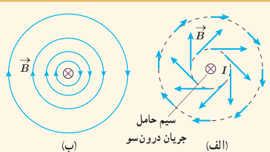
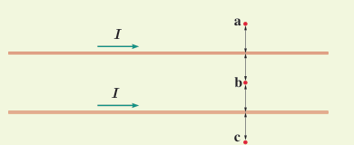

### پرسش ۳ـ۷

دریافت خود را از شکل‌های الف و ب بیان کنید. در بیان خود، به چگونگی تغییر جهت و اندازۀ میدان $\vec B$ در اطراف سیم حامل جریان اشاره کنید.

### تمرین ۳ـ۳

جهت میدان مغناطیسی برآیند (خالص) را ناشی از سیم‌های موازی و بلند حامل جریان را در هر یک از نقطه‌های a، b و c پیدا کنید. نقطۀ b در فاصلۀ مساوی از دو سیم قرار دارد.

### فناوری و کاربرد: میدان‌های مغناطیسی بدن

تمام یاخته‌های زندۀ بدن انسان به‌طور الکتریکی فعال‌اند. جریان‌های الکتریکی ضعیف در بدن، میدان‌های مغناطیسی ضعیف ولی قابل اندازه‌گیری تولید می‌کنند. اندازۀ میدان‌های حاصل از عضله‌های اسکلتی کوچک‌تر از $10^{-10}\,\mathrm T$، یعنی در حدود یک میلیونیم میدان مغناطیسی زمین است. میدان‌های مغناطیسی حاصل از مغز بسیار ضعیف‌تر و در حدود $10^{-12}\,\mathrm T$ هستند و برای اندازه‌گیری آنها باید مغناطیس‌سنج‌های بسیار حساس به کار برد. در حال حاضر، چنین مغناطیس‌سنج‌هایی به نام اسکوئید¹ ساخته شده‌اند. شکل روبه‌رو یک دستگاه اسکوئید را نشان می‌دهد که در حال اندازه‌گیری میدان مغناطیسی تولید شده در مغز است.

**نیروی بین سیم‌های موازی حامل جریان:** در آزمایش اورستد، دیدیم که در فضای اطراف هر سیم حامل جریان، میدان مغناطیسی وجود دارد. همچنین در بخش ۳ـ۴ با نیروی مغناطیسی وارد بر سیم حامل جریان آشنا شدیم. حال فرض کنید برای تولید میدان مغناطیسی به جای آهن‌ربا، از یک سیم حامل جریان استفاده کنیم. اگر سیم حامل جریان دیگری را در نزدیکی این سیم قرار دهیم، آیا نیرویی بر آن وارد می‌شود؟ آزمایش نشان می‌دهد که پاسخ این پرسش مثبت است. به طوری که اگر جریان‌ها در یک جهت از دو سیم موازی بگذرند، نیروی بین آنها ربایشی است (شکل ۳ـ۱۶ الف). همچنین اگر جریان‌ها در دو جهت مخالف از دو سیم موازی بگذرند، نیروی بین آنها رانشی است (شکل ۳ـ۱۶ ب).

۱ـ SQUID (Superconducting Quantum Interference Device)
