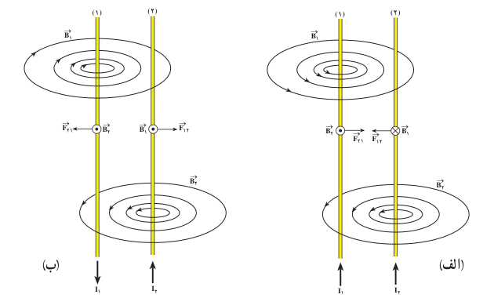
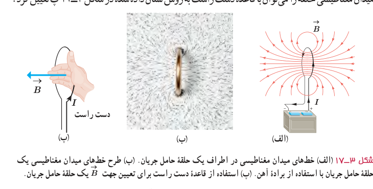
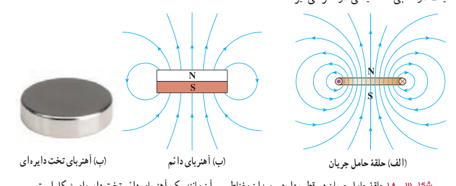

شکل ۳ـ۱۶ نیروی مغناطیسی‌ای که دو سیم موازی حامل جریان به یکدیگر وارد می‌کنند. الف) برای جریان‌های همسو، ربایشی است و ب) برای جریان‌های ناهمسو، رانشی است.

**میدان مغناطیسی ناشی از یک حلقۀ دایره‌ای حامل جریان:** شکل ۳ـ۱۷ الف خط‌های میدان مغناطیسی را در اطراف یک حلقۀ رسانای دایره‌ای نشان می‌دهد که حامل جریان $I$ است. همان‌طور که دیده می‌شود خط‌های میدان مغناطیسی در ناحیۀ داخل حلقه به یکدیگر نزدیک‌ترند؛ یعنی، میدان در این ناحیه قوی‌تر است. افزون بر این، در نقطه‌های روی محور حلقه، میدان موازی محور حلقه است. جهت خط‌های میدان مغناطیسی حلقه را می‌توان با قاعدۀ دست راست به روش نشان داده شده در شکل ۳ـ۱۷ پ تعیین کرد.

شکل ۳ـ۱۷ الف) خط‌های میدان مغناطیسی در اطراف یک حلقۀ حامل جریان. ب) طرح خط‌های میدان مغناطیسی یک حلقۀ حامل جریان با استفاده از برادۀ آهن. پ) استفاده از قاعدۀ دست راست برای تعیین جهت $\vec B$ یک حلقۀ حامل جریان.

بررسی و مقایسۀ میدان مغناطیسی یک حلقۀ حامل جریان و یک آهن‌ربای تخت دایره‌ای شکل، نشان می‌دهد که میدان مغناطیسی آنها مانند یکدیگر است (شکل ۳ـ۱۸). به همین دلیل، هر حلقۀ حامل جریان را به‌عنوان یک دوقطبی مغناطیسی در نظر می‌گیرند.

شکل ۳ـ۱۸ حلقۀ حامل جریان دو قطب دارد و میدان مغناطیسی آن مانند یک آهن‌ربای دائم تخت دایره‌ای شکل است.
